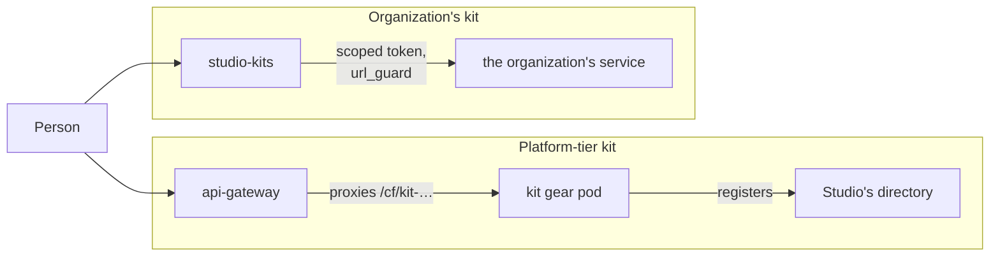

# ADR-0077: A kit's gear runs beside Studio and joins it through the directory; an organization's kit code runs as its own service

**ID**: `cpt-studio-adr-kit-gears-at-runtime`

Status: **proposed** · Date: 2026-11-23 · Builds on `cpt-studio-adr-shell-and-kits` (ADR-0068 §8–§10: a kit service, WebAssembly functions, kits as OCI artifacts), `cpt-studio-adr-spec-mapping-kit` (ADR-0074 amendment C: a kit's strategy run by a service the organization connects), `cpt-studio-adr-component-tiers` (ADR-0042: platform and organization tiers), `cpt-studio-adr-one-platform-release` (ADR-0075) · Design: `cpt-studio-design-kit-gears-runtime`

## Table of Contents

<!-- toc -->

- [Context and Problem Statement](#context-and-problem-statement)
- [Considered Options](#considered-options)
- [Decision Outcome](#decision-outcome)
  - [1. Who publishes the kit decides how its code runs](#1-who-publishes-the-kit-decides-how-its-code-runs)
  - [2. The host is configured, not rebuilt](#2-the-host-is-configured-not-rebuilt)
  - [3. A kit names the gears it runs](#3-a-kit-names-the-gears-it-runs)
  - [4. Studio builds and deploys the gear, and the gear registers itself](#4-studio-builds-and-deploys-the-gear-and-the-gear-registers-itself)
  - [5. Every hop authenticates, and Studio holds the gear to the kit's permissions](#5-every-hop-authenticates-and-studio-holds-the-gear-to-the-kits-permissions)
  - [6. The contribution points take a kit gear](#6-the-contribution-points-take-a-kit-gear)
  - [7. An organization's kit runs code as its own service, by contract](#7-an-organizations-kit-runs-code-as-its-own-service-by-contract)
  - [8. WebAssembly and rebuilding keep their place](#8-webassembly-and-rebuilding-keep-their-place)
- [Phases](#phases)
- [Consequences](#consequences)
- [Confirmation](#confirmation)
- [Open questions](#open-questions)

<!-- /toc -->

## Context and Problem Statement

Kits already bring types, screens, rules and claims without a redeploy
(ADR-0068, ADR-0070, ADR-0071), and micro-frontends load at run time. Code is
the exception. A manifest may declare `functions` (`wasm` | `agent`) and
`services`, but nothing runs them; Project lifecycle's one function is compiled
into studio-kits. Every gear is linked into one backend binary
(`studio-backend/src/registered_gears.rs`), so a kit that needs a gear today
needs a Studio release.

The owner asks: **can a kit's gear start up and work with Studio's backend,
without rebuilding the backend binary?**

The platform's answer, read from gears-rust at `36e51d81` and from the crates
Studio pins (toolkit 0.13.1, api-gateway 0.7.4, service-discovery 0.4.2), is
yes. A gear runs out of process with its own HTTP server, probes and drain. It
registers its REST endpoint and OpenAPI with the directory (service-discovery,
formerly gear-orchestrator) and heartbeats. The embedded api-gateway
reverse-proxies its exposed routes with the route auth policy applied. The PDP
answers over `/authz-resolver/v1/evaluate`, and types-registry takes GTS
publications over REST. Studio has none of it switched on: grpc-hub listens on
a Unix socket, the gateway proxy is off, and no kit can say "run this gear".

Two platform gaps decide who may use this. A remote gear acts only with the
caller's bearer token, because there is no service identity per tenant and no
token exchange. A remote gear cannot be a plugin of an in-process host
(remote plugins are P2). The evidence, file by file, is §2 of the design.

## Considered Options

1. **Kit gear as a joined service.** Studio builds the gear's image via
   Gearbox and deploys it beside the backend. The gear registers itself in
   Studio's directory and is routed by the gateway.
2. **WebAssembly functions in process** (wasmtime) for small logic
   (ADR-0068 §9).
3. **External service by contract.** The organization connects an endpoint,
   as for assembly strategies (ADR-0074 C).
4. **Rebuild Studio with the kit's gears.** Studio is a Gearbox product.

The comparison covers security, tenancy, cost, and operations on Dev, Test,
the stand and the Desktop. It is in §4 of the design.

## Decision Outcome

Chosen: **1 for kits whose publisher the platform trusts, 3 for an
organization's own kits**. 2 comes after the pilot under the same capability
model, and 4 stays the promotion path.

### 1. Who publishes the kit decides how its code runs

A joined gear holds the person's token on every call, so where kit code runs
follows the publisher:

| Publisher | Kit code runs as |
|---|---|
| Constructor, or a kit the platform curated (ADR-0042 platform tier) | a **joined kit gear**: one shared instance per platform, beside the backend |
| An organization, for itself | **its own service by contract**, an endpoint the organization binds; later also WebAssembly functions |

### 2. The host is configured, not rebuilt

The backend binary does not change. Its configuration gains, behind a
profile:

- grpc-hub on a TCP address with platform-plane auth enforced (`kube` SA tokens
  on Dev/Test, `shared_secret` on the stand);
- service-discovery limited to Studio's namespace, so each gear registers
  under its own name only;
- `api-gateway.gateway_proxy` on.

Without enforced platform auth the directory accepts any registration under
any name, so the TCP listener never opens without it.

### 3. A kit names the gears it runs

A new manifest section, `run_gears` (`kit_gear(...)` in `kit.gdl`), names
each gear the kit runs. Each entry has the gear id `kit-<slug>-<name>`, the
package and version (a gear is a published package, ADR-0078 on its branch),
an optional image digest, its routes (all under `/<gear>/v1/`), the MCP tools
mapped to those routes, resources and whether it needs a database. Only a
platform-tier kit may carry the section. It is separate from `gears` (claims
on Studio's gears) and `services` (infra services, ADR-0065).

### 4. Studio builds and deploys the gear, and the gear registers itself

Installing the kit on the platform starts a run in studio-tasks, shown in
Background work. studio-environments builds or pulls the image. The build is
Gearbox's one-gear application: the kit package plus authn-resolver and the
deployment's authn plugin, at the platform release's versions. The image goes
into the platform's registry, pinned by digest.

studio-environments then deploys a release into Studio's own namespace, or a
compose service on the stand. The release has a service account named after
the gear, a NetworkPolicy, limits, and a database and role of the gear's own.

The gear registers itself and publishes its GTS types. Studio needs no
bridge. The run waits until the directory says the gear is ready, then turns
on the kit's claims, MCP tools and Inbox sources.

- An upgrade is a new digest.
- Uninstall stops the release once no organization has the kit, and keeps the
  data until a purge.
- An organization's install switches what the kit contributes on or off. It
  never starts a process.

### 5. Every hop authenticates, and Studio holds the gear to the kit's permissions

Each hop checks the request:

1. The gateway authenticates the person.
2. The kit gear re-validates the token with its linked authn-resolver.
3. The kit gear asks Studio's PDP about its own resources over REST.

The PDP gives a kit's resource type the tenant clamp from the first call.

The gear can replay the person's token to any Studio route, and the platform
cannot narrow it. Studio therefore adds a **kit egress check** on its own
routes. A call from a kit gear carries the gear's platform-plane identity;
Studio maps that identity to the kit and refuses every route the kit's
approved `permissions` do not list. WebAssembly host functions will go
through the same check.

Until the check exists, a joined gear's publisher is trusted, which is why
§1 limits joined gears to the platform tier.

### 6. The contribution points take a kit gear

- **Routes** are served at `/cf/<kit gear>/v1/…`. In-process routes win a
  clash, and the name rule keeps the two apart.
- **MCP tools** of `run_gears` are added by studio-kits, with schemas from
  the gear's OpenAPI in the directory. A tool call goes through the gateway
  as the person.
- **Inbox `endpoint` sources** may name a `GET` route of the kit's own gear
  that `permissions.reads` lists.
- **Claims and the model overlay** stay the manifest's (ADR-0070, ADR-0071).

### 7. An organization's kit runs code as its own service, by contract

ADR-0074 C is generalised from strategies to any kit route:

- **The contract.** `kit-service/v1` is `GET /v1/info` plus the routes the
  manifest declares, each with a schema.
- **The binding.** The organization binds the endpoint and secret as a
  `kit-service` connection, and the address passes `url_guard`.
- **The call.** studio-kits calls the service as the person, with a token
  Studio mints for that service: audience the service, the organization, the
  kit's scopes, five minutes. The person's IdP token never leaves Studio.
- **Deployment.** studio-environments may deploy the service into the
  organization's own environment.

### 8. WebAssembly and rebuilding keep their place

- **WebAssembly.** ADR-0068 §9 stands, built after the pilot. Its host
  functions go through the kit egress check, so a kit's `permissions` bind
  both kinds of code the same way.
- **Rebuilding.** Rebuilding Studio with a kit's gear is how a kit gear
  becomes core. It is also the fallback for a gear that has to be an
  in-process plugin until the platform has remote plugins.

## Phases

| Phase | Delivers | Depends on |
|---|---|---|
| 1 | Pilot on the stand: Project lifecycle's phase function as the kit gear `kit-project-lifecycle-phase` (design §9) | — |
| 2 | Dev/Test: `kube` platform auth, the kit gear chart, NetworkPolicy, deploy into Studio's namespace | 1 |
| 3 | The kit egress check on Studio's routes | 1 |
| 4 | `kit-service/v1` for organizations' kits, optionally deployed by studio-environments | 3 |
| 5 | WebAssembly functions behind the same check (ADR-0068 phase 8) | 3 |
| 6 | Remote plugins and token exchange, when the platform has them | upstream |

## Consequences

- Good: a platform kit's gear ships, upgrades and rolls back without a
  backend release. Its failure stops its own routes, not Studio.
- Good: nothing in the platform has to change for the pilot. The host side is
  configuration in versions Studio already pins.
- Good: an organization's code never holds a person's IdP token and never
  runs inside Studio's trust boundary.
- Bad: a pod per kit gear, a database per gear, and a TCP directory to secure
  and operate.
- Bad: a joined gear sees every organization that installed the kit. Its
  tenant isolation is its own code's and the PDP's, as for any gear, and
  until the egress check it can call any Studio route as the person.
- Bad: a kit gear builds against the platform release, so a platform bump is
  a rebuild of every kit gear.

## Confirmation

The pilot's exit criteria (design §9), all on the stand, with the backend's
image digest the same before install, after install and after uninstall:

- the kit gear's routes behave as the in-process ones, including the PDP's
  403;
- nothing answers without a token, and a registration under another gear's
  name is refused;
- MCP tools and an Inbox endpoint source work through Studio;
- the gear's type is in types-registry;
- a killed gear turns to 503 within its lease and comes back by itself;
- uninstall removes its routes within one proxy sync;
- proxied p95 overhead is under 10 ms.

## Open questions

1. Only platform-tier kits may run a joined gear (recommended), or also
   organizations?
2. One shared instance per platform (recommended), or per organization?
3. Accept the person's token in Constructor's kit gears until the egress check
   (phase 3), or build the check first?
4. Where platform kit gear images live: the cluster's registry or ghcr.
5. WebAssembly after the pilot, as ADR-0068 §9 says, or dropped for agent
   functions plus `kit-service/v1`?
6. Does a platform release bump rebuild every kit gear, or may a kit gear
   keep its toolkit within a compatible minor?
7. May an organization's service call back into Studio (a Studio-signed,
   kit-scoped token), or return results only?
