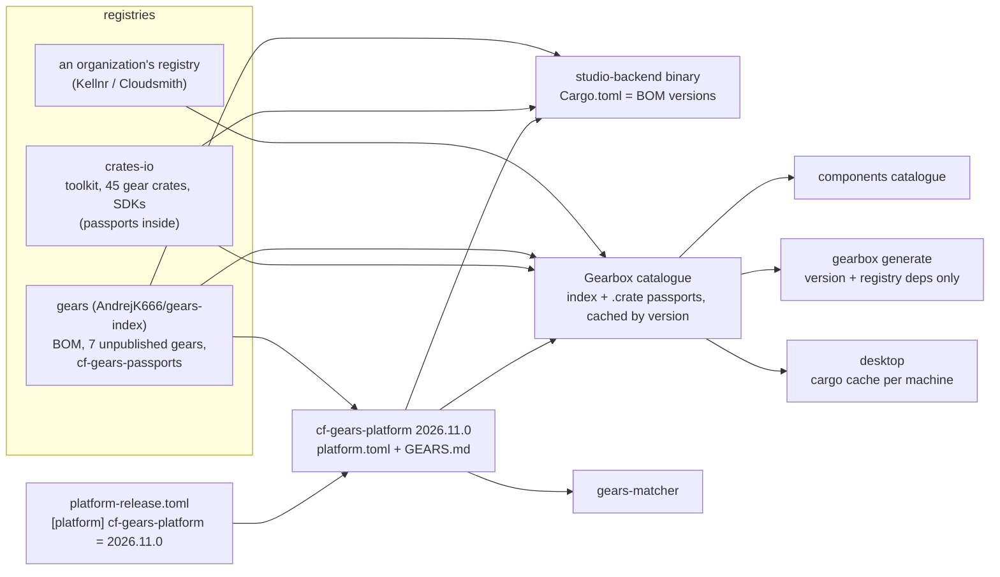

# Technical Design — gears as packages

- [ ] `p2` - **ID**: `cpt-studio-design-gears-as-packages`

A gear is distributed the way a .NET library is: as a versioned package in a
registry. The package carries the gear's code and its passport (`gear.gdl`). A
platform release is one version of one package, the BOM, that pins every gear.
Gearbox builds its catalogue from registries and generates products that name
gears by version. Nobody reads gears-rust from a git checkout any more:
Studio's binary, the engine, the component catalogue, the gears matcher and the
desktop all read the same packages. The decision is
[ADR-0076](../adr/0076-gears-are-published-packages-and-a-platform-release-is-a-bom-version.md).
It builds on [ADR-0075](../adr/0075-one-platform-release-pins-gears-rust-and-gearbox.md)
(one release file) and amends
[ADR-0046](../adr/0046-gears-come-from-connected-gear-repositories.md)
(gear repositories). The evidence is the
[inventory](gears-as-packages-inventory.md).

This is a design. Nothing in it is built yet.

| .NET | Gears |
|---|---|
| NuGet package (`.nupkg`) with its `.nuspec` | crate (`.crate`) with its `Cargo.toml` and `gear.gdl` |
| nuget.org | crates.io |
| a private feed (Azure Artifacts, a folder feed) | the `gears` registry: a git index and GitHub release assets |
| `Microsoft.AspNetCore.App`, Central Package Management (`Directory.Packages.props`) | the BOM `cf-gears-platform` |
| `packages.lock.json` | `Cargo.lock` |
| `NuGet.config` with `packageSourceCredentials` | `.cargo/config.toml` `[registries]` with a `credential-provider` |
| a project reference to your own code | the product's own crate, a `path(...)` source |

## Table of Contents

<!-- toc -->

- [1. Problem](#1-problem)
- [2. What the inventory changed](#2-what-the-inventory-changed)
- [3. Model](#3-model)
  - [3.1 A gear is a package with its passport](#31-a-gear-is-a-package-with-its-passport)
  - [3.2 Identity](#32-identity)
  - [3.3 Registries](#33-registries)
  - [3.4 The BOM](#34-the-bom)
  - [3.5 Before and after](#35-before-and-after)
- [4. Registry choice](#4-registry-choice)
- [5. Publishing and versioning](#5-publishing-and-versioning)
- [6. Gearbox engine changes](#6-gearbox-engine-changes)
- [7. Studio changes](#7-studio-changes)
- [8. Authentication](#8-authentication)
- [9. Where the registry configuration comes from](#9-where-the-registry-configuration-comes-from)
- [10. Migration](#10-migration)
- [11. Risks](#11-risks)
- [12. What we ask upstream](#12-what-we-ask-upstream)
- [13. Open questions](#13-open-questions)

<!-- /toc -->

## 1. Problem

Studio reads gears-rust in at least six places, and each one picks its own
copy. The integration map of 2026-11-23 found three source repositories, seven
git checkouts of five commits, and crates.io:

| Reader | What it reads | From where |
|---|---|---|
| the studio-backend binary | the `cf-gears-*` crates | crates.io, through `studio-backend/Cargo.lock` (toolkit 0.13.1) |
| the backend's Gearbox catalogue (Dev, stand) | the corpus | env `STUDIO_GEARBOX_CORPUS_URL/_REF`, Helm `corpusUrl/corpusRef` (`studio-backend/src/product/gearbox.rs`, `deploy/helm/values-dev.example.yaml`) |
| `product.gdl` and `gearbox generate` | descriptions, plus the source of every gear the lock does not pin | `source(id = "gears-rust", at = git(url, rev = "75f5d9ea…"))` |
| the component catalogue | the crates.io keyword `constructorfabric` at the latest versions, plus repository scans with its own `gear.gdl` parser | `studio-backend/src/components_catalog/` |
| the gears matcher | `docs/GEARS.md` and every `gear.gdl` of one checkout | its own clone, at its own pins (`[gears_matcher]`) |
| the desktop | a corpus clone, one per machine | the `url@rev` the portal relays; `constructorfabric/gears-rust` by default (`theia/gearbox-studio/src/common/gearbox-preferences.ts`) |

Because each reader picks its own copy, they drift apart, and the drift
surfaced on Dev, not in review:

- **GBX0714, two copies of a platform crate.** The lock moved to toolkit 0.13.1
  while `product.gdl` stayed on a 0.12 commit. Any gear the lock did not pin
  was built from the corpus and linked a second toolkit. Studioweb's builds and
  Research's `prepare` failed. Today only a hand-placed anchor keeps it shut
  (`cf-gears-rg-tr-plugin =0.2.2` in `studio-backend/Cargo.toml`, ADR-0075 §6
  for `weftgraph`). The class of failure is still open: any gear that is not
  in the lock is built from the corpus.
- **The corpus outran the engine.** This happened on 2026-10-06, 2026-10-17
  and 2026-10-23. A floating branch picked up GDL the engine could not read,
  and the catalogue came back empty or answered 500.
- **Studio's code outran the engine's parser of `#[toolkit::gear]`.** The
  toolkit-macros 0.8 syntax `gts_publication(...)` raised GBX0102 on
  `studio-authz-plugin`.
- **Three gear identities.** The engine uses the id, the catalogue the crate
  name, and the matcher `gears-rust/<slug>` with aliases. On top of these come
  a fixture of gear directories (`studio-backend/src/gears_matcher/fixtures/`)
  that goes stale without notice, and a frontend that accepts all three
  spellings.
- **The desktop on an older engine**, because its archive hashes were empty.
- **A cold catalogue read of 11–37 s.** It re-projects every root's Rust
  sources on every read. A package version never changes, so the work could be
  done once and cached.

ADR-0075 put every pin in one file and added a gate that checks the pins
agree. It cannot check that the corpus *is* the release the lock links. The
corpus is a commit of a fork branch, and the lock is a set of crates.io
versions. This design removes the corpus, so that the lock, the catalogue and
the product all name the same thing: package versions.

## 2. What the inventory changed

The direction was agreed on two premises. Passports exist only on the fork,
because gears-rust#4793 is not merged. Many gears therefore need republishing
with their passport. The [inventory](gears-as-packages-inventory.md) shows that
neither premise holds any more:

- **#4793 merged upstream on 2026-10-24.** Since the release of 2026-10-28,
  every gear crate release-plz publishes carries its `gear.gdl`. Cargo packages
  the whole crate directory, and no gear crate restricts it with `include`.
  46 of the 47 corpus gears on crates.io have their passport in the latest
  `.crate`. **All 25 gears-rust gears of Studio's product have it in the very
  version Studio's lock links.**
- **The corpus is older than what Studio links.** For every gear of the
  product, the corpus at `75f5d9ea` is below the lock: `oagw` 0.6.2 against
  0.8.1, and toolkit 0.12 against 0.13.1. Its one fix of its own is already
  published.

So crates.io already is the gear registry for the platform. Our own registry
only has to hold:

- the gears that upstream does not publish: seven gears in 17 crates;
- the passport of `event-broker`, the one published gear without it;
- the BOM;
- later, the organizations' own gears.

Only these go into the fork of gears-rust. The fork stops being a corpus at all.

## 3. Model

### 3.1 A gear is a package with its passport

A gear package is a crate with:

- `src/` containing the `#[toolkit::gear(...)]` attribute. This holds the
  identity, capabilities and deps the engine projects (ADR-0002 of Gearbox).
- `gear.gdl` beside `Cargo.toml`. This holds everything the attribute does not:
  name, description, maturity, category, the SDK, config, features and serves.

A package may carry more than one gear. A plugin compiled into its host has its
`gear.gdl` beside its own attribute inside the host's package:
`cf-gears-mini-chat` carries `mini-chat`, `static-mini-chat-audit-plugin` and
`static-mini-chat-model-policy-plugin`. `package.path` and `attr` stay
relative to the passport, as they are today.

The passport's SDK reference (`sdk = cargo(crate_name, path = "../x-sdk")`) is
resolved by `crate_name` against the other packages the fetch brought. The
relative path is meaningless in an unpacked crate, and the engine's
`registry.rs` already says so.

The package carries **neither documents nor charts**:

- cargo cannot package a file outside the crate directory;
- a gear family keeps `docs/` beside its crates, not inside one.

A passport's documents resolve to its `source = git(url, path)` URL instead,
which the engine already falls back to. A chart a passport names
(`helm_chart(path = ...)`) must live inside the crate. That is a rule for
gear authors and is checked by publishing (§5).

**Design gears** have a passport and no code (`implementation = "design"`).
There are nine in the corpus. They are not packages in phases 1–3. If the
catalogue needs them from the registries, each becomes a *passport-only
package* `cf-gears-<id>` with an empty `lib.rs`, its `gear.gdl` and its
`docs/`. That is a decision for phase 4 (§10).

**The product's own gears stay its own code.** Studio's 47 gears are modules of
`cf-studio-backend`, and its usage-collector plugin is a path crate. They are
the product, as a .NET project's own code is not a NuGet package. They remain a
`path("studio-backend")` source. This design does not lower their 26 s
projection cost (map §3.6); option C of ADR-0075's alternatives remains the
answer to that.

### 3.2 Identity

The **package** is the unit of distribution and version, and the **gear id**
is the unit of composition. They are the same name except where a package
carries several gears.

- **Catalogue key**: `<package>` for a package with one gear, which is 44 of
  the 45 published gear crates. For the others it is `<package>#<gear id>`,
  for example `cf-gears-mini-chat#static-mini-chat-audit-plugin`. The component
  catalogue already keys graph nodes by crate name (`catalog_graph/gts.rs`), so
  it changes least.
- **Engine id**: the gear id. `product.gdl` keeps `use_gear("api-gateway")`;
  the source's `prefix = "cf-gears-"` turns it into the package name, and
  `use_gear(package = ...)` handles the exceptions (`cf-chat-engine`,
  `weftgraph`). This already exists in the engine's GDL (`registry(name,
  prefix)`).
- **Matcher id**: the catalogue key. `gears-rust/<slug>`, the alias tables and
  the directory fixture all go away (§7).

`graph-storage` is published twice. The product names one package for it,
`use_gear("graph-storage", package = "weftgraph", version = "=0.4.0-rc.3")`,
until it moves to `cf-gears-graph-storage`, which upstream publishes as well
(0.4.1). Which one is a product decision; the identity rule does not choose.

### 3.3 Registries

Two registries:

- **`crates-io`**: everything upstream publishes, that is the toolkit, 45 gear
  crates and their SDKs.
- **`gears`**: ours, holding exactly the following.
  - The seven unpublished gears and their 17 crates: `admission-control`,
    `policy-engine`, and the five BSS gears with `cf-gears-bss-coord`, `-rest`,
    `-approval` and `cf-gears-toolkit-policy-evaluation`.
  - `cf-gears-passports`, a package of passports for crates.io packages that
    lack one, keyed `<package>/<version requirement>/gear.gdl`. Today this is
    only `cf-gears-event-broker`. No code is ever republished under a
    crates.io name (§11).
  - The BOM, `cf-gears-platform`.

An organization's gears go to the registry the organization chooses (§7.4).

**A name lives in one registry.** crates.io does not allow its packages to
depend on another registry. So dependencies only point from `gears` to
`crates-io`, never back. Publishing to `gears` refuses a name that the
crates.io index has (§5).

**Layout of `gears`.** The repository `AndrejK666/gears-index` contains:

```
config.json                     {"dl": "https://github.com/AndrejK666/gears-index/releases/download/{crate}/{crate}-{version}.crate",
                                 "api": null}
ad/mi/cf-gears-admission-control      one JSON line per version (cargo's index format v2)
cf/-g/...                             (the standard 1/2/3/{a}/{ab}/{cd} prefixes)
```

There is one GitHub release per crate, tagged with the crate's name, and one
asset per version: `{crate}-{version}.crate`. GitHub caps the number of assets
per release, so the cap becomes a limit on versions per crate rather than per
registry. `"api": null` says there is no publish API: the local script writes
the index (§5).

Cargo reads the index as a sparse registry over
`https://raw.githubusercontent.com/AndrejK666/gears-index/main/`, with
`index = "sparse+https://…/"`. This is the same protocol crates.io uses, so the
engine and Studio fetch a gear's entry with one HTTP GET. GitHub's raw CDN
caches for up to five minutes, so a version is visible to builds a few minutes
after publishing. The publish script waits until it is. The git URL of the
same repository is the fallback `index`.

### 3.4 The BOM

`cf-gears-platform` in `gears`, version `YYYY.M.N` (for example `2026.11.0`),
is one platform release. It carries:

- `platform.toml`, the data, read by Gearbox, Studio and the matcher:

  ```toml
  [release]
  gears_rust = "009fdc7c…"         # the upstream release commit the crates.io versions were cut from
  toolkit = "0.13.1"

  [gears.api-gateway]               # gear id -> package and exact version
  package = "cf-gears-api-gateway"
  version = "0.7.4"
  registry = "crates-io"

  [gears.graph-storage]
  package = "weftgraph"
  version = "0.4.0-rc.3"
  registry = "crates-io"

  [gears.admission-control]
  package = "cf-gears-admission-control"
  version = "0.1.0"
  registry = "gears"

  [sdks]                            # every SDK and toolkit library a product may link, same shape
  ```

- `GEARS.md`, the platform's catalogue prose, which the matcher reads today
  from a checkout;
- `Cargo.toml` with one optional dependency per gear, each `=`-pinned, and one
  feature per gear id that turns it on. This is the cargo-level guard. A
  product that also depends on `cf-gears-platform` with the features of its
  gears cannot resolve another version of them: cargo refuses the conflict
  instead of building a second copy.

The BOM is **data first**, and the guard comes second. Cargo has no
`dependencyManagement`. A `version = "*"` in a product would still resolve to
the newest semver-incompatible version beside the BOM's, so that the product
ends up with two copies. So generation always writes exact `=` versions taken
from `platform.toml` (the engine already writes `{ version = "=X", registry }`),
and the guard only catches a hand edit.

A BOM version is cut from one upstream release train. release-plz publishes
the whole workspace from one commit, and every `.crate` records that commit
in `.cargo_vcs_info.json`. A BOM is the set of latest versions published from
commits up to and including `[release].gears_rust`, plus the `gears` registry's
versions built against that train's toolkit (§5).

### 3.5 Before and after

Before: every reader picks its own gears-rust.

```mermaid
flowchart LR
  CIO["crates.io<br/>cf-gears-* (lock: toolkit 0.13.1)"]
  FORK["AndrejK666/gears-rust@75f5d9ea<br/>(toolkit 0.12)"]
  MF["MikeFalcon77/gears-rust<br/>feature/gearbox (floats)"]
  UP["constructorfabric/gears-rust<br/>62d89b0 / 70a5354 / main"]
  BIN["studio-backend binary<br/>Cargo.lock"]
  CAT["components catalogue<br/>keyword scan + own gdl parser"]
  ENG["Gearbox catalogue<br/>(corpus root)"]
  GEN["gearbox generate<br/>lock + git rev + path deps"]
  MATCH["gears-matcher<br/>own clone, gears-rust/&lt;slug&gt;"]
  DESK["desktop<br/>corpus clone per machine"]
  CIO --> BIN
  CIO -->|latest| CAT
  MF -->|Dev, stand| ENG
  FORK -->|product.gdl rev| GEN
  BIN -->|--cargo-lock| GEN
  UP -->|pins| MATCH
  UP -.->|default| DESK
  ENG -->|url@rev relay| DESK
```

After: one BOM version, read by everything; gear code only from registries.



## 4. Registry choice

| | Git index + GitHub release assets | Kellnr (self-hosted) | Cloudsmith / Artifactory (SaaS) |
|---|---|---|---|
| What it is | an index repository plus one release per crate; a local script publishes | a Rust registry server (sparse index, `cargo publish` API, crates.io proxy, rustdoc) | a hosted multi-format package service with Cargo support |
| Runs | nothing. GitHub serves both, and Actions are not needed | a pod with a volume and a database in our cluster | their service |
| `cargo publish` | no. `"api": null`, and the script writes the index | yes | yes |
| Private packages | **no.** A private repository's release assets cannot be fetched by cargo's `dl` template, because GitHub wants the asset API with a token | yes, `auth-required`, a token per user | yes |
| crates.io proxy and cache | no | yes | yes |
| Yank | edit the index line, then commit | `cargo yank` | `cargo yank` |
| Cost | none | a deployment to run, back up and upgrade | a subscription |
| Fits | the open-source platform gears we republish, and the BOM | an organization's private gears; air-gapped installs | the same, without running it |

**Recommendation: git index plus GitHub releases now; Kellnr when the first
organization needs private gears.**

- Everything `gears` holds today is Apache-2.0 platform code, so public is
  right.
- It needs no server and no Actions.
- A git index is the oldest registry format cargo has, so nothing in it is
  exotic.
- The moment it cannot serve is a private gear. That is phase 4, and at that
  point Kellnr runs beside it as the organization's registry, not instead of it
  (§7.4).

Cloudsmith or Artifactory is the answer only if the company already pays for
one.

## 5. Publishing and versioning

**The script** is `scripts/publish-gear.mjs` in the gears-rust fork, run
locally. It is the only way into `gears`. It:

1. Refuses a crate whose name the crates.io sparse index knows (§3.3), and a
   version the `gears` index already has. Versions are immutable.
2. Refuses a crate whose `toolkit` requirement does not admit the BOM's
   toolkit. A gear built against another train links a second toolkit (the
   GBX0714 class).
3. Refuses a gear crate without `gear.gdl` at its root, or whose passport
   names a chart or an attribute file outside the crate.
4. Runs `cargo package --registry gears`. This rewrites path and workspace
   dependencies to versions and fails on a path-only dependency (for
   `policy-engine` that means three of them).
5. Computes the SHA-256 and writes the index line from the packaged
   `Cargo.toml`: `name`, `vers`, `deps` (a crates.io dependency carries
   `"registry": "https://github.com/rust-lang/crates.io-index"`), `cksum`,
   `features`, `links`, `rust_version`, `v: 2`.
6. Runs `gh release upload <crate> <file>`, creating the release if needed,
   then commits the index line, pushes, and waits until the raw URL serves it.

A publish is a commit in `gears-index`, so the index's history is the audit
log.

**The fork's manifests.** Upstream leaves these crates unpublishable, so the
fork changes exactly that:

- `publish = ["gears"]` instead of `publish = false`;
- a `version` for the BSS crates, which have none;
- `version` on every path dependency.

Nothing is renamed: the names are free on crates.io and stay `cf-gears-*`.
The fork branch is cut from the upstream release commit of the BOM's train, so
these crates build against the same toolkit as the crates.io gears. Each new
train means a rebase and a republish, which is the drift cost (§11).

**Versions in `gears`:**

- A gear upstream does not publish keeps its manifest's version line, starting
  at `0.1.0`, and follows semver.
- If upstream later publishes the name on crates.io, consumers move there with
  the next BOM, and our versions are yanked.
- No version in `gears` ever shares a name with crates.io.

**Not allowed, and why:**

- **`0.7.6+fork.1` (build metadata).** Cargo ignores build metadata when it
  resolves and compares versions. crates.io, and a well-behaved index, treat
  `0.7.6+fork.1` as the same version as `0.7.6`. It distinguishes nothing.
- **`0.7.6-fork.1` (a pre-release).** It sorts *below* `0.7.6`. A `^0.7.6`
  requirement in another gear does not match a pre-release, so that gear pulls
  the crates.io copy beside ours and links two copies.
- **The same name in both registries.** Cargo treats `cf-gears-x` from two
  sources as two different packages. Both can enter one graph, and types from
  one are not types from the other: this is GBX0714 again.

**A fix that upstream has not released**, to a crate on crates.io, is
therefore not a registry version. The product gets a
`[patch.crates-io] cf-gears-x = { git = "<fork>", rev = "<commit>" }`. The
patch is visible in the product and recorded in its lock. It is temporary, and
an upstream PR carries the fix. When upstream releases it, the next BOM drops
the patch.

**The BOM's version** is calendar semver `YYYY.M.N`. It is always consumed with
`=`, so semver ranges never apply to it. `N` increases for a re-cut within a
month: a newer patch of one gear, or a yank.

**Yanking.**

- In `gears`, yanking sets `"yanked": true` on the index line and commits it.
  Locks that pin the version keep building, and new resolutions skip it.
- A gear version is yanked only when it is broken. The BOMs that name it are
  then re-cut (`N+1`), and the BOM versions themselves are yanked.
- A BOM is never yanked while a Studio release or a saved product revision
  names it and still builds.
- On crates.io, yanking is upstream's. A BOM that names a version upstream
  yanked still resolves with its lock, and the next BOM moves off it.

## 6. Gearbox engine changes

The engine is the fork `AndrejK666/gearbox` at `82b909a`. Much of the
registry path already exists but is not wired in:

- `registry.rs` fetches gear packages through cargo, which handles
  authentication, the cache and mirrors;
- the GDL already has `registry(name, prefix)` sources and
  `use_gear(version, package)`;
- `generate/manifest.rs` already writes `{ version = "=X", registry }`.

Paths below are relative to the engine repository.

| # | Where | Today | Change |
|---|---|---|---|
| E1 | `crates/gearbox-cli/src/main.rs` 40–201, `open_source_roots` 666–692 | `--root` is repeatable and required for `catalogue`, `resolve`, `validate`, `generate` and `rpc` | `--root` becomes optional. Add `--bom <package>@<version>` and `--registry <name>=<index>`; a product's `registry(...)` sources are enough on their own |
| E2 | `crates/gearbox-cli/src/pipeline.rs` 53–118; `crates/gearbox-rpc/src/lib.rs` 336–360 | open `--root` and `path(...)` sources only. `registry::fetch` is never called | call `registry::fetch` for `registry(...)` sources, with the gears the product names, or with the BOM's list for a catalogue |
| E3 | `crates/gearbox-engine/src/registry.rs` | `fetch` through a seed manifest and `cargo metadata`. Each fetched package becomes a root whose source id is the crate's name | keep the declared source id (`gears`, `crates-io`) on the root. The lookups by source id in `generate/frontx.rs` 287–300, `generate/ui.rs` 211–244 and `generate/unit_chart.rs` 42–49 miss otherwise |
| E4 | `crates/gearbox-engine/src/source.rs` `to_resolved` 139–146, `with_declared_paths` 262–295, `lock_sources` 314–333 | every root is `SourceKind::Path`, digested by content | `SourceKind::Registry { registry, package, version, cksum }`, digested by the index checksum |
| E5 | `crates/gearbox-engine/src/merge.rs` `cargo_ref` 601–633, `sdk_refs` 701–727, `crate_dir` 1363–1383 | `CargoRef.path` is root-relative, so `../x-sdk` leaving an unpacked package fails with `bad_crate_path` even though `siblings` resolves it | resolve by `crate_name` through `siblings` first, and accept a path that leaves a registry root when the crate name resolves |
| E6 | `crates/gearbox-engine/src/catalogue.rs` `discover_files` 1338–1369 | walks a root for every `gear.gdl` | unchanged for a package: one package may carry several (`cf-gears-mini-chat`). Add a passport overlay: a crates.io package without `gear.gdl` takes it from `cf-gears-passports` |
| E7 | new: a catalogue over an index | none. A catalogue is the walk of roots on disk | `catalogue --bom`: list the BOM's gears, fetch each `.crate` (cargo's cache), read the passports, project the attributes, and **cache the result by `(package, version, cksum)`**. A published version never changes, so the cache never invalidates. This replaces the 11 s corpus read with a lookup after the first time |
| E8 | `crates/gearbox-ir/src/catalogue.rs` `GearDescriptor` 515–744; `crates/gearbox-ir/src/contract.rs` `CargoRef` 336–372 | no version and no registry on a gear | add `package.version` and `package.registry`, and carry them into `ResolvedGear` (`crates/gearbox-ir/src/resolved.rs`) |
| E9 | `crates/gearbox-engine/src/generate/manifest.rs` 197–409 (`TOOLKIT_SUBDIR` 19, used at 208–221 and 264–288), `located` 436–456 | the toolkit and `toolkit-db` are found as `libs/toolkit` under the anchor gear's root; a gear is a path dependency unless the plan names it | registry-only mode: every gear, SDK and toolkit crate comes from the BOM's `platform.toml` as `{ version = "=X", registry }`. No path into a corpus. A `path(...)` source (the product's own code) stays a path |
| E10 | `crates/gearbox-engine/src/generate/workspace.rs` `workspace_manifest` 73–117, `cargo_lock` 153–175 | writes `[patch]` back to checkouts; seeds the lock from a source root's `Cargo.lock` | write `.cargo/config.toml` with the product's `[registries]` (names and indexes, never tokens). Seed from the product's own lock only |
| E11 | `crates/gearbox-engine/src/locked.rs` `CRATES_IO_SOURCES` 63–66, `LockedVersions::parse` 251–280, `"crates.io"` written at 228, 409, 436, 499, 506 | a lock entry is crates.io or git; entries from another registry are ignored | parse `registry+<url>` and `sparse+<url>` sources and map them to the registry's name |
| E12 | `crates/gearbox-engine/src/locked.rs` `apply` 545–739 (the two-copies loop 670–700) | GBX0714 when a gear built from source reaches a pinned crate by path | with no corpus, no gear is built from source, so the check shrinks to "a crate locked at two versions". Keep it as the guard |
| E13 | `crates/gearbox-engine/src/published.rs` 4–5, 616–618; `docs/gdl.md` 1123 | "a published crate carries no `gear.gdl`", and the comparison with `.cargo_vcs_info.json` leaves it out | correct both: since 2026-10-28 a published gear crate carries it. `crates = registry(...)` on a `path(...)` source becomes a transition aid and is removed in phase 5 |
| E14 | `crates/gearbox-engine/src/docs.rs` `project` 48–122 | looks for `docs/` beside the passport, then one directory up | in a package, use `docs/` inside the crate if there is one, else the passport's `source = git(url, path)` URL (this already happens on a miss) |
| E15 | `crates/gearbox-engine/src/generate/docker.rs` `dockerignore` 102–125, `build_context` 213–219 | the build context is the common ancestor of all roots | roots under `~/.cargo/registry` make that ancestor the home directory, or fail across drives. Build from the output tree alone, since dependencies come from the registries in the image build |
| E16 | `crates/gearbox-rpc/src/lib.rs` 2874–2900 | the RPC computes `published::for_product` only, not `locked::*`, so Studio's previews differ from the CLI | the same plan for both |
| E17 | GDL (`crates/gearbox-gdl/src/product.rs`, `product_intent.rs`) | `use_gear(version)` on each gear | `platform = bom(package, version, source)` on the product: a `use_gear` without `version` takes the BOM's. This is phase 3; phase 2 writes the versions out |

E1–E5, E8, E9 and E11 are the pilot's minimum. E7 is what makes the catalogue
fast. E12, E13 and E15 are clean-up the pilot exposes.

## 7. Studio changes

### 7.1 `product.gdl`

The `gears-rust` git source becomes two registry sources. The product's own
code stays a path source:

```
sources = [
    source(id = "platform", at = registry("crates.io", prefix = "cf-gears-")),
    source(id = "gears", at = registry("gears", prefix = "cf-gears-")),
    source(id = "studio-backend", at = path("studio-backend")),
],
platform = bom(package = "cf-gears-platform", version = "2026.11.0", source = "gears"),   # E17, phase 3
gears = [
    use_gear("api-gateway", source = "platform", version = "=0.7.4"),                    # phase 2: written from the BOM
    use_gear("graph-storage", source = "platform", package = "weftgraph", version = "=0.4.0-rc.3"),
    use_gear("studio-product", source = "studio-backend"),
    ...
]
```

`scripts/product-gdl.mjs` writes it from `platform-release.toml` and the BOM,
as it writes the git source today. ADR-0060's rule ("a revision pins each
source") holds: a registry source with a BOM version is pinned.

### 7.2 `platform-release.toml`

| Section | Today | After |
|---|---|---|
| `[gears_rust]` | repo plus corpus commit | **gone.** The BOM's `[release].gears_rust` says which upstream commit the train is, for information |
| `[toolkit]` | `0.13.1` | **gone.** It is in the BOM |
| `[gears_matcher]` | two commits of `constructorfabric/gears-rust` | **gone.** The matcher reads the BOM |
| `[platform]` | — | `package = "cf-gears-platform"`, `version = "2026.11.0"`, `registry = "gears"`, `index = "sparse+https://raw.githubusercontent.com/AndrejK666/gears-index/main/"` |
| `[gearbox]`, `[gearbox_desktop]` | engine release and hashes | unchanged |

`scripts/platform-release.mjs --write` derives these from it:

- the `=` versions in `studio-backend/Cargo.toml`, for every gears-rust crate
  the backend links (taken from `platform.toml`);
- `product.gdl`;
- the Helm and compose registry values (§9).

`check-platform-release.mjs` adds two checks. `Cargo.lock` must resolve each
crate at exactly the BOM's version. No corpus variable may be set anywhere.
The anchor `cf-gears-rg-tr-plugin =0.2.2` and ADR-0075 §6's lock-reading
workaround become unnecessary: every gear is named by version.

### 7.3 Component catalogue (`studio-backend/src/components_catalog/`)

- **The crates.io keyword scan** (`cratesio.rs`, `mod.rs` `DEFAULT_KEYWORD`)
  stops being the list of gears. It reported the *latest* versions, which are
  not the ones Studio links. The list is now the BOM's gears plus each
  organization's registry. The keyword scan may remain as a "newer than your
  platform" hint.
- **Passports** are read from the engine's catalogue of the BOM (E7), not from
  Studio's hand parser over repository scans (`repo_enrich.rs`).
  `repo_enrich`'s `gear.gdl` reader then serves only organization git sources,
  until those move to registries too.
- **Keys** stay crate names, which is the catalogue key of §3.2. A
  multi-gear package adds `#<id>`.
- **ADR-0061's `PlatformPin { repo, git_ref }`** becomes
  `PlatformPin { bom_version }`. An organization's pin is then the same pin
  the engine reads, which closes the gap the map recorded: the pin acted on
  the graph but not on the engine.

### 7.4 Gear-repository connector (ADR-0046)

ADR-0046 made a tier's gear sources connections of kind `gear-repository`, each
a git URL and ref. Two changes follow:

- **A new kind, `gear-registry`.** Its fields are `name` (the cargo registry
  name), `index` (a sparse or git URL), `credential` (a credstore reference,
  optional) and `prefix`. The connector plugin
  (`gear-repository-connector-plugin`) gains it beside the git kind.
- **Tiers:**
  - the platform tier has `crates-io` and `gears`, set from
    `platform-release.toml`, not by hand;
  - an organization adds its own registries, for example a Kellnr. Its
    products then use `source(id = "<org>", at = registry("<org>"))`.

The git kind remains for an organization's unpublished work in progress, and
for design gears until they become passport-only packages. Once an
organization publishes, the catalogue reads its registry: the same code path
as the platform's.

### 7.5 gears-matcher

- **Its catalogue** is the BOM. The matcher downloads `cf-gears-platform` at
  the version Studio sends with the run, takes `GEARS.md` from it, and reads
  the passports of the BOM's gears through Studio's
  `/studio-product/v1/gearbox/catalogue?bom=<version>`. It has no clone. It
  also stops depending on GitHub, which the matcher's Helm values set today.
- **Ids** are the catalogue key. `gears-rust/<slug>`, `aliases.py`, the `--2`
  suffixes, `B/gears_matcher/fixtures/gear-directories.json` and the
  never-called `gears_matcher::mapping` (the directory join) are deleted.
- `product/gear_match` (`report.rs` `pick_of`) looks the key up in the BOM
  and gets the gear id.

### 7.6 Builds, Research, previews

`environments/build.rs`:

- `prepare_as` no longer clones a `gears-rust` source. Only the project's own
  repository is cloned.
- `product_lock` and `seed_lock` keep the product's lock.
- The prepare Job needs the registry configuration (§9), and needs network
  access to the registries. It already needs crates.io.

Research's `prepare` is the same function, so it inherits all of this. The
`PRODUCT_NOT_COMPOSED` diagnosis for GBX0714 stays but should no longer fire.

### 7.7 Desktop

- **The corpus clone goes away**: the per-machine `~/ConstructorStudio/corpus`
  in `theia/gearbox-studio/src/node/git-sources.ts`, and the relay of `url@rev`
  in `gearbox-service-impl.ts`. Cargo's own cache, `~/.cargo/registry`, is the
  per-machine copy instead, and it already works offline (`--offline`).
- **What the portal relays** is the registry list and the BOM version.
- **The default source** in `gearbox-preferences.ts` (a
  `constructorfabric/gears-rust` clone) becomes the platform's registries.
- **The source id `gears-rust`** hard-coded as `CORPUS_CHECKOUT`
  (`gear-locations.ts`, `gearbox-environment.ts`) goes. "Open the gear's
  source" opens the unpacked package read-only, or the passport's
  `source = git(...)` URL.

## 8. Authentication

- **Reading `crates-io` and `gears`** needs no credentials: both are public.
- **Publishing to `gears`** needs the owner's `gh` login. The script pushes
  the index and uploads release assets, and no cargo token is involved.
- **An organization's private registry** (Kellnr, Cloudsmith) needs a cargo
  token. Cargo's credential providers decide where it comes from:

```toml
# .cargo/config.toml, written by Studio/Gearbox: names and indexes, never secrets
[registries.acme]
index = "sparse+https://kellnr.acme.example/api/v1/crates/"
credential-provider = ["cargo:token"]        # Dev, Test, stand: the token comes from the environment

[registry]
global-credential-providers = ["cargo:token", "cargo:wincred", "cargo:macos-keychain"]   # desktop
```

| Where | Token source |
|---|---|
| Dev, Test (prepare Jobs, the backend's catalogue) | the organization's `gear-registry` connection keeps the token in credstore. Studio injects it as `CARGO_REGISTRIES_<NAME>_TOKEN` into the engine subprocess and the prepare Job's environment, never into a file |
| stand | the same, from the stand's credstore |
| desktop | `cargo:wincred` on Windows, `cargo:macos-keychain` on macOS, filled once from the portal through the keychain broker the desktop already has. Alternatively a `cargo-credential-studio` provider asks the signed-in desktop session for a short-lived token |

The token is per user or per organization robot, scoped to read. Kellnr and
Cloudsmith issue such tokens. A registry with `auth-required: true` in its
`config.json` makes cargo send the token for index reads as well as downloads.

## 9. Where the registry configuration comes from

The configuration is two names, two indexes and one BOM version. All of it is
derived from `platform-release.toml`, like every pin since ADR-0075:

| Place | How it gets the configuration |
|---|---|
| studio-backend image, builder image | `CARGO_REGISTRIES_GEARS_INDEX` in the Dockerfiles' `ENV`, written by `platform-release.mjs --write`. `crates-io` is cargo's default |
| Dev, Test | Helm `values.yaml` `gearbox.platform.{bom,registries}` replaces `corpusUrl/corpusRef`, written into `values-dev.example.yaml`, and Dev's real values follow in the same change. Organization registries come from their connections at run time |
| stand | `docker-compose.yml` environment, written by the same script |
| a generated product | `.cargo/config.toml` in the output tree (E10), so the product builds anywhere: CI, Research, a laptop |
| desktop | the portal relays registries and the BOM version, and the engine passes them to cargo as `CARGO_REGISTRIES_*` for its subprocesses. The user's `~/.cargo/config.toml` is never edited |
| gears-matcher | `GEARS_PLATFORM_BOM` (version) and `GEARS_REGISTRY_INDEX` in its Helm values. Studio sends the BOM version with each run, so the values are only a default |

## 10. Migration

Each phase is one branch and one PR on the fork (`AndrejK666/studio-web`
main, `AndrejK666/gearbox`, `AndrejK666/gears-rust`). Nothing goes upstream
until the owner says so.

**Phase 0: this document and the inventory.** Done when ADR-0076 is accepted.

**Phase 1: pilot, three gears.** Each one exercises a different path:

| Gear | Why it is in the pilot |
|---|---|
| `rg-tr-plugin` (`cf-gears-rg-tr-plugin`, crates.io, Studio lock `0.2.2`) | a plugin in Studio's product with a passport on crates.io, and the gear that caused GBX0714 twice, which the lock anchor holds shut today. Proves crates.io plus a passport from the `.crate` plus version-only generation |
| `admission-control` (`cf-gears-admission-control` + `-sdk`, `publish = false`) | the smallest gear that must go to `gears`: two crates, a path dependency to its SDK, no unpublished library. Proves the registry, the publish script and the fork's manifest changes |
| `graph-storage` (`weftgraph =0.4.0-rc.3` against `cf-gears-graph-storage`) | the name mismatch: a gear id whose package is not `cf-gears-<id>`, in Studio's product. Proves `use_gear(package = ...)` and the catalogue key |

Steps:

1. Create `AndrejK666/gears-index` with `config.json`.
2. Fork branch `gears-as-packages` of gears-rust from the upstream release
   commit of Studio's train. Change the two admission-control manifests and
   publish them with the script, then a pilot BOM `2026.11.0-pilot.1` naming the
   three gears.
3. Engine branch: E1–E5, E8, E9 and E11.
4. A pilot product (`products/pilot/product.gdl`) with the three gears, two
   registry sources and versions.

Exit criteria:

- `gearbox catalogue --registry gears=<index> --bom cf-gears-platform@2026.11.0-pilot.1` (a pilot BOM naming the three) lists
  the three gears with their passports read from `.crate` files, with **no
  `--root`**. Their ids are `rg-tr-plugin`, `admission-control` and
  `graph-storage`, and their catalogue keys are the packages.
- `gearbox generate` for the pilot product writes a `Cargo.toml` with only
  `version`/`registry` dependencies: no `path` into a corpus and no `[patch]`.
  GBX0713 reports three of three from registries, and there is no GBX0714.
- `cargo generate-lockfile` and `cargo fetch` in the generated tree succeed
  against both registries from a clean `CARGO_HOME`.
- `cargo check` of the generated tree passes. This is a Rust build: it runs
  only with the owner's go-ahead, in the builder image.
- A second `catalogue` call over the same versions is served from the
  version-keyed cache (E7). Both times are recorded against the corpus read's
  11 s.

**Phase 2: Studio's platform from the BOM.**

- Cut `cf-gears-platform 2026.11.0` from Studio's lock: the 25 gears-rust
  gears, their SDKs, the toolkit libraries and `weftgraph`.
- `platform-release.toml` gets `[platform]`.
- `studio-backend/Cargo.toml` takes its versions from the BOM.
- `product.gdl` gets registry sources with versions written out.
- `prepare` stops cloning gears-rust.
- `cf-gears-passports` carries `event-broker`.

Exit: a Studioweb build on Dev and in Research composes with no corpus, and
the `rg-tr-plugin` anchor is deleted.

**Phase 3: every reader on the BOM.** The engine catalogue gets E6 and E7,
and the GDL gets `platform = bom(...)` (E17). Then:

- the component catalogue, the matcher (ids, no clone, fixtures deleted) and
  the desktop (no corpus) read the BOM;
- the Helm and compose corpus variables are removed;
- ADR-0061's pin becomes a BOM version.

Exit: `grep -r corpus` over deploy and compose finds nothing. The matcher's and
the catalogue's gear lists are equal for one BOM.

**Phase 4: organizations' registries.**

- the `gear-registry` connection kind;
- a Kellnr deployment in the webstudio cluster for private gears;
- token injection (§8);
- publishing from Studio: "Publish gear" runs `cargo publish --registry <org>`
  from the gear's project, with the same checks as §5;
- passport-only packages for design gears, if wanted.

Exit: an organization publishes a gear, and another of its projects composes
it by version.

**Phase 5: clean-up.**

- delete `[gears_rust]`, `[toolkit]` and `[gears_matcher]`;
- remove the corpus code paths in `product/gearbox.rs`, `gear_roots.rs` and
  `git-sources.ts`;
- engine E12 and E13 (`crates = registry(...)` on a path source);
- ADR-0046 is amended to say that registries are the gear sources.

## 11. Risks

- **Drift from upstream gears-rust.** Our registry holds gears that upstream
  does not publish, built on a fork branch. Every new train means a rebase and
  a republish of 17 crates. Mitigations:
  - keep that set small, and ask upstream to publish them (§12);
  - the publish script refuses a toolkit mismatch;
  - a BOM is cut only when every `gears` crate has a version on its train.

  This is the same drift the corpus had, now limited to 7 gears instead of 65.
- **Publishing discipline.** A version cannot be replaced, only yanked.
  Mitigations:
  - one script is the only path in;
  - it runs `cargo package` (which builds the crate) before uploading;
  - the index is a git history;
  - the BOM is cut from what is published, never from a working tree.

  The risk is a forgotten step (assets uploaded, index not pushed). The
  script's last step, waiting for the raw URL, makes that visible.
- **The same crate name in two registries.** Cargo treats a name as two
  packages when it has two sources, and a graph can hold both. This is the
  GBX0714 class with another cause. Mitigations:
  - the publish script refuses a crates.io name;
  - `cf-gears-passports` overlays a passport without republishing code;
  - an unreleased fix to a crates.io crate is a visible `[patch]`, never a
    registry version (§5).

  If upstream later publishes a name we hold, the next BOM moves to crates.io
  and ours is yanked.
- **Build metadata and pre-releases.** `+fork.N` is invisible to resolution,
  and `-fork.N` sorts below the release and escapes `^` requirements. Neither
  is used (§5). `weftgraph =0.4.0-rc.3` is a pre-release that upstream chose.
  It only works because it is pinned with `=`, and the BOM keeps it that way.
- **A public registry only.** GitHub release assets cannot serve private
  gears, so phase 4 needs Kellnr or a SaaS. Until then an organization's
  private gears stay on ADR-0046's git sources.
- **The raw CDN's cache.** A newly published version is invisible for up to
  five minutes. The publish script waits, and a BOM is never cut in the same
  minute as its last gear.
- **Docs and charts outside packages.** A gear's documents become URLs into
  its repository, at the commit `.cargo_vcs_info.json` names. A chart a
  passport names must be inside the crate; `cluster`'s is in neither place
  today.
- **The engine fork.** E1–E17 land on `AndrejK666/gearbox`, which is already
  ahead of upstream (constructorfabric/gearbox#17). Each change is also an
  upstream PR.

## 12. What we ask upstream

- **gears-rust#4793 is merged** (2026-10-24), so the passport is no longer an
  ask.
- **`event-broker`'s passport inside its crate.** Move
  `gears/system/event-broker/gear.gdl` into `event-broker/` and set
  `package.path = "."`. Then `cf-gears-passports` becomes empty.
- **Publish the unpublished gears**: `admission-control`, `policy-engine`
  with `cf-gears-toolkit-policy-evaluation`, and the BSS family. For BSS that
  means versions on its crates and `publish` turned on. Each one published
  upstream is one fewer in `gears`.
- **One name per gear on crates.io.** `graph-storage` is published as
  `cf-gears-graph-storage` and, from a personal fork, as `weftgraph`. Upstream
  should say which name is the gear and stop the other. Likewise,
  `cf-chat-engine` and `cf-{postgres,redis,k8s}-cluster-plugin` should follow
  `cf-gears-<id>`, or their passports should say `package`.
- **Charts and documents a passport names live inside the crate**, or the
  passport says they are URLs.
- **A release train manifest.** release-plz publishes the workspace from one
  commit. A published `cf-gears-platform` from upstream itself, with the same
  `platform.toml`, would make our BOM a copy. That is the end state.
- **Gearbox**: E1–E17 as PRs to `constructorfabric/gearbox`, and fix the
  contradiction between `published.rs` and `docs/gdl.md` (E13).

## 13. Open questions

- **`weftgraph` or `cf-gears-graph-storage`** for Studio: this depends on
  which one carries the features Studio uses. It is a product decision that
  the pilot exposes.
- **Design gears as passport-only packages** (phase 4), or a separate
  `designs` source the catalogue reads beside the registries.
- **Whether Studio's own 47 gears should ever be a package.** Not for
  distribution. Possibly so that the engine caches their projection (26 s) by
  version, as E7 does for platform gears.
