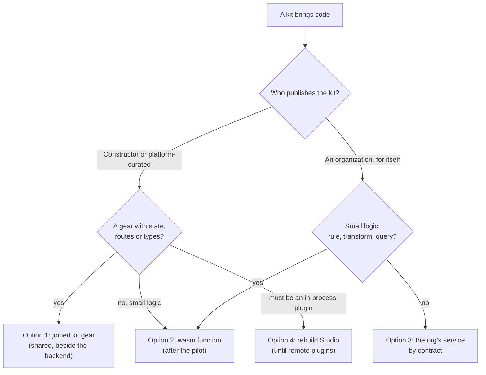
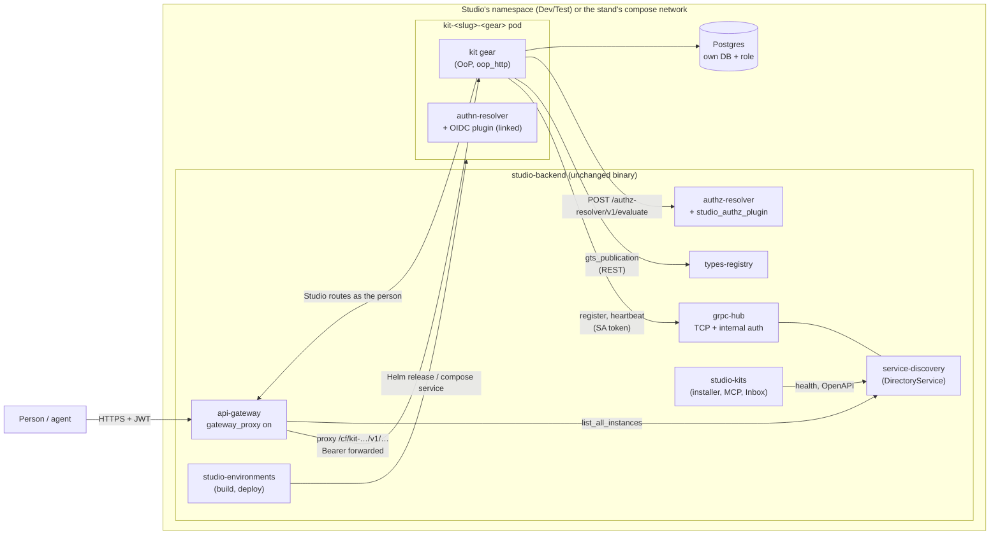
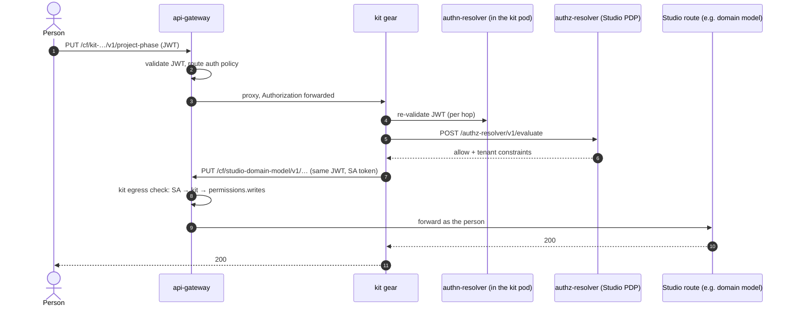
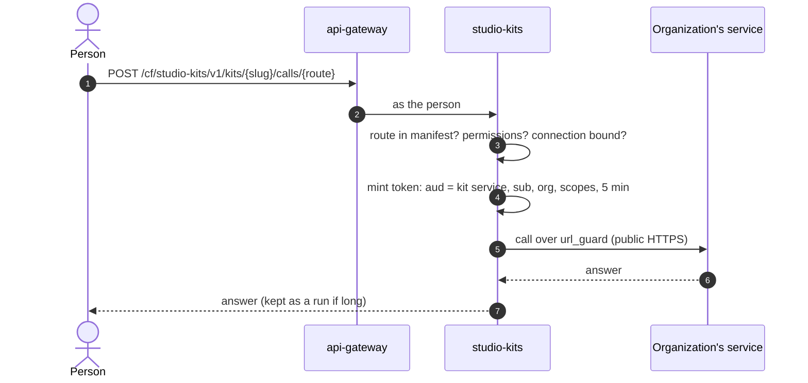

# Technical Design — kit gears at run time

- [ ] `p2` - **ID**: `cpt-studio-design-kit-gears-runtime`

The question: a kit can bring its own gear. Can that gear start, join the
Studio backend, serve its routes behind the gateway, publish its types, answer
the PDP and show up in MCP and the Inbox, **without rebuilding the Studio
backend binary**? This document records what the platform (gears-rust) can do
today, compares four ways to run kit code, and specifies the recommended one.
The decision is [ADR-0077](../adr/0077-a-kit-gear-runs-beside-studio-and-joins-it-through-the-directory.md);
the kit model it extends is [studio-kits](studio-kits.md) and
[ADR-0068](../adr/0068-studio-is-a-shell-and-everything-inside-it-comes-from-kits.md).

## Table of Contents

- [1. The short answer](#1-the-short-answer)
- [2. What the platform supports today](#2-what-the-platform-supports-today)
- [3. What Studio does today](#3-what-studio-does-today)
- [4. Four ways to run kit code](#4-four-ways-to-run-kit-code)
- [5. Recommendation](#5-recommendation)
- [6. Kit gears as joined services](#6-kit-gears-as-joined-services)
- [7. An organization's kit service, by contract](#7-an-organizations-kit-service-by-contract)
- [8. WebAssembly functions](#8-webassembly-functions)
- [9. Pilot](#9-pilot)
- [10. Phases](#10-phases)
- [11. Open questions for the owner](#11-open-questions-for-the-owner)

## 1. The short answer

**Yes, for the platform; not yet, for Studio.** gears-rust already runs a gear
out of process (OoP): the gear starts its own HTTP server, registers its REST
endpoint and OpenAPI with the directory, heartbeats, and the embedded
api-gateway reverse-proxies its exposed routes with authentication applied.
All of it is in the crates Studio already pins (toolkit 0.13.1, api-gateway
0.7.4, service-discovery 0.4.2), so the host side is **configuration**, not a
new binary. What is missing is Studio's: a kit has no way to say "run this
gear", nothing builds or deploys one, Studio's directory listens only on a
Unix socket, the gateway proxy is off, and the kit contribution points (MCP
tools, Inbox endpoints, claims) accept only Studio's own gears.

Two platform gaps shape the design. A remote gear acts **only with the
caller's bearer token** (no service-to-service tenant identity, no token
exchange), and a remote gear **cannot be a plugin** of an in-process host
(remote plugins are P2). Both limit who may bring a running gear: a gear that
holds people's tokens must come from a publisher the platform trusts.

## 2. What the platform supports today

Read from a fresh clone of `constructorfabric/gears-rust` at `36e51d81`
(2026-11-23, toolkit 0.15.0) and checked against the `.crate` files of the
versions in `studio-backend/Cargo.lock` (downloaded from crates.io). Paths
below are in gears-rust.

| Capability | State | Evidence |
|---|---|---|
| OoP bootstrap: one gear as its own process | **works** | `libs/toolkit/src/bootstrap/oop.rs` `run_oop_with_options` (l. 506): config from the master (`TOOLKIT_MODULE_CONFIG`), logging, OTEL, lazy directory client, signals, graceful shutdown. Present in 0.13.1. |
| OoP HTTP serving: routes, probes, drain | **works** | `libs/toolkit/src/runtime/oop_serve.rs`: `/healthz`, `/readyz` (gated on dependencies), `/health`, `/.well-known/openapi.json`, two-plane auth, drain with `503 + Retry-After`. Turned on by an `oop_http` config block (`config/oop-hello.yaml`). |
| Self-registration, heartbeat, self-heal | **works** | `libs/toolkit/src/runtime/oop_registration.rs`: registers gRPC/REST endpoints and the OpenAPI spec, backoff 100 ms → 30 s, re-registers after a directory restart. `RegisterInstanceInfo` carries `rest_endpoint`, `openapi_spec`, `labels`, `reported_state` (`libs/system-sdks/sdks/directory/src/api.rs` l. 268). 0.14 moved lease renewal to a `PresenceManager`. |
| Directory (what the handover calls gear-orchestrator) | **works**, in memory | `gears/system/service-discovery`: renamed from gear-orchestrator (`CHANGELOG.md` l. 6263). gRPC `DirectoryService` over grpc-hub; leases (`src/config.rs`, TTL 30 s + grace 30 s). Persistence and replication are ADR-0011 of `docs/arch/toolkit-oop/` (accepted). |
| Who may register under a gear's name | **works when platform-plane auth is on** | `src/domain/authz.rs`: the peer's identity must equal the gear name, or be a `trusted_registrars` entry; SA namespace and SPIFFE trust-domain allow-lists. `src/server.rs` l. 100–131: on a listener **without** enforced platform auth every mutation is allowed. |
| Gateway routing to a remote gear | **works**, off by default | `gears/system/api-gateway/src/proxy.rs`: with `gateway_proxy.enabled` the gateway polls `list_all_instances` and reconciles a reverse-proxy table; `src/gear.rs` l. 379–387 extends the route auth policy to proxied routes; l. 785–790 mounts the forwarder as the fallback (in-process routes win). Config in 0.7.4 (`GatewayProxyConfig`). |
| Tenant plane in the remote gear | **works if the gear links authn** | Per-hop JWT re-validation (`docs/arch/toolkit-oop/ADR/0008-…two-plane-auth.md`). There is no remote `AuthNResolverClient`: `gears/system/authn-resolver/authn-resolver-sdk/src/bearer.rs` says an OoP gear wraps its *in-process* resolver. `oop.rs` l. 777–835 leaves `bearer_authenticator: None`; `oop_serve.rs` l. 898–920 picks one up from the ClientHub if authn-resolver is linked. Without one, tenant routes are refused (`libs/toolkit-http-middleware/src/auth.rs`, `TenantPlane::Absent`, fails closed). |
| PDP over the wire | **works** | `gears/system/authz-resolver/authz-resolver/src/gear.rs` l. 24–40: the contract's REST projection `/authz-resolver/v1/evaluate`, an internal tenant-plane route "so out-of-process PEPs can reach the PDP"; consumers declare `#[toolkit::consumes(contract = AuthZResolverApi, from = "authz-resolver")]`. Present in Studio's 0.4.2. |
| GTS types from a remote gear | **works** | `gears/system/types-registry/types-registry-sdk/src/lib.rs` l. 62–64 (`PlatformTypesRegistryApiRestResolvingClient`), `publication.rs`; `gts_publication(...)` in `#[toolkit::gear]` publishes through it. Present in Studio's sdk 0.5.2. |
| Typed clients between gears | **works for gears with contracts** | `#[toolkit::contract]` / `#[toolkit::rest_contract]` / `#[toolkit::consumes]` (`libs/toolkit-contract*`, DESIGN § REST Client Codegen). Studio's own gears have no SDK contracts; a kit gear reaches them over their REST routes. |
| Platform-plane credentials | **partial** | `shared_secret` (dev, single node) and `kube` (projected SA tokens) work; the Flight-Control bootstrap token and mTLS/SPIFFE do not (DESIGN § Platform-Plane Authentication, current state). |
| Service-to-service tenant identity, token exchange | **missing** | Edge Mode B2 token exchange is P2 (`docs/arch/toolkit-oop/ADR/0007-…edge-architecture.md` l. 133). A remote gear acts only with the token it was called with. |
| A remote gear as a plugin of an in-process host | **missing** | DESIGN § Plugin Transport Abstraction (P2): the plugin pattern is "entirely in-process". A kit cannot ship, say, an authz or credstore plugin as a separate process. |
| Spawning and lifecycle | **local only** | `libs/toolkit/src/backends/mod.rs` l. 89–108, `OopBackend` / `LocalProcessBackend`: the host can spawn local processes. On Kubernetes the lifecycle is Helm's (`docs/arch/toolkit-oop/ADR/0004-…helm-chart-organization.md`, `toolkit-common` library chart). |
| Reference composition | **exists** | `apps/cf-gears-flight-control`: directory + grpc-hub + api-gateway (proxy on) + types-registry + authn-resolver; everything else OoP. `config/oop-flight-control.yaml` is the host config a Studio stand would copy. |
| Gearbox: one gear as its own application | **exists** | `docs/GEARBOX.md`: the resolver places gears into applications per deployment profile and marks bindings that cross an application boundary. Registry-sourced gears were not built on 2026-09-14; ADR-0076 (gears are published packages, on its own branch) addresses that. |
| WebAssembly | **absent** | No `wasmtime` in either `Cargo.lock`. `gears/serverless-runtime` is design only (`gear.gdl`: `implementation = "design"`); its ADR-0005 (thin host) names WASM a "potential" backend. |

Two documents have drifted from the code and should not be trusted on these
points: the "Current state" sections of `docs/arch/toolkit-oop/DESIGN.md`
still say there is no reverse proxy and no REST registration (both exist),
and Studio's [backend handover](../backend-handover.md) §7 lists a
`gear-orchestrator` that is now `service-discovery`.

## 3. What Studio does today

- **One binary.** `studio-backend/src/registered_gears.rs` links every gear;
  the set "is fixed; optional parts are Cargo features, never runtime
  plugins". service-discovery and grpc-hub are linked, but grpc-hub listens on
  `uds:///tmp/cf-studio-backend-grpc` (`studio-backend/config/docker.yaml`
  l. 172–174), so nothing outside the process can reach the directory, and no
  profile sets `gateway_proxy`.
- **Kit manifests describe code that nothing runs.** `functions` (`wasm` |
  `agent`) and `services` (`use_service(...)`, ADR-0065) are checked and
  classified (`kind: runtime`, [studio-kits](studio-kits.md) §3.14), never
  executed. Project lifecycle's one function is compiled into studio-kits
  (`phase.rs`) "until kit functions run in Studio's function runtime" (§3.10).
- **Contribution points know only Studio's gears.** An Inbox `endpoint`
  source must start with `/studio-` (`kit_registry/manifest.rs` l. 752); MCP
  tools are a compiled list (`mcp/mod.rs`, `tools()`); claims name Studio
  gears (ADR-0071).
- **Precedent for external code.** ADR-0074's amendment C: an organization's
  kit may declare `service: {contract: "gears-matcher/v1"}`; the organization
  binds the endpoint and secret as an `assembly-service` connection; Studio
  calls it and keeps its results.
- **The PDP takes any resource.** `studio_authz_plugin` role-gates the Studio
  resources it maps and gives every other resource the tenant clamp, so a kit
  gear's own resource types get tenant isolation from the first call.
- **Egress.** oagw is linked only with the `llm` feature, which is off in the
  k8s image; Studio's own provider calls go through studio-llm-proxy (ADR-0039).
- **studio-environments** builds images (rootless BuildKit Job, Gearbox in the
  builder), pushes them to an organization's registry, and installs charts into
  an organization's environments (ADR-0043, ADR-0048, ADR-0062). It has never
  deployed into Studio's own namespace.

## 4. Four ways to run kit code

| | 1. Kit gear as a joined service | 2. WebAssembly in process | 3. External service by contract | 4. Rebuild Studio with the kit's gears |
|---|---|---|---|---|
| What runs | The kit's gear crate, built into its own image, beside the backend; it registers in Studio's directory | A `.wasm` component inside the backend (wasmtime) | A service the organization runs anywhere, speaking a contract Studio defines | The kit's crate linked into `cf-studio-backend` by Gearbox |
| Studio binary rebuilt | no | no (once the runtime exists) | no | **yes** |
| Platform support | yes (§2), host config only | none: a new runtime, host functions, limits | none needed (HTTP client, as gears-matcher) | yes (Studio is a Gearbox product) |
| Tenant isolation | the gear's own code, under the PDP; it sees every tenant that calls it | sandbox; host functions run as the kit principal through the PDP | per organization by construction (its own endpoint) | the gear's own code, in Studio's process and memory |
| Holds people's tokens | **yes** (per-hop JWT) | no | no: Studio sends a scoped token | yes, and everything else in the process |
| Secrets | its config secret and its own DB role; tenant secrets stay in credstore | none; host functions only | the organization's, in its connection (credstore) | all of Studio's |
| Egress | NetworkPolicy: Studio's gateway and directory only; outbound via oagw / llm-proxy routes | none unless a host function gives it | the service's own; Studio reaches it through `url_guard` | Studio's |
| Multi-tenancy | one shared instance per platform | shared runtime, per-call limits | one per organization | shared |
| Cost | a pod per kit gear (≥ 64 Mi, a DB schema) | CPU and memory inside the backend pod | the organization pays | none extra; a release per kit change |
| Dev / Test | Helm release in Studio's namespace via studio-environments | none extra | a connection per organization | a backend release |
| Stand | a compose service from the image | none extra | a local container or a URL | a stand rebuild (25 min+) |
| Desktop | nothing local: the desktop reads the server | nothing local | nothing local | nothing local |
| Who can bring it | publishers the platform trusts | anyone (sandboxed) | any organization, for itself | Constructor only |
| Best for | real gears with state, routes and types | rules, transforms, Inbox queries | heavy or proprietary work, strategies, organization code | a gear promoted into the core |

## 5. Recommendation

A combination keyed by **who publishes the kit**, because the deciding
property is that a joined gear holds the person's bearer token (§2):

1. **Constructor's and platform-curated kits** (the platform tier of ADR-0042)
   run their gears as **joined services (option 1)**. One shared instance per
   platform, deployed and upgraded by Studio when the kit is installed on the
   platform, with no backend rebuild.
2. **An organization's own kits** run code as an **external service by
   contract (option 3)**, generalising ADR-0074 C from strategies to any kit
   route: the organization binds an endpoint; Studio calls it with a short,
   audience-bound token it mints, never the person's IdP token. Studio may
   deploy that service into the organization's own environment with
   studio-environments, so "the org connects an endpoint" can be one click.
3. **WebAssembly functions (option 2)** stay ADR-0068 §9, sequenced **after**
   the pilot, for small logic of any kit. The capability model of §6.6 is the
   one wasm host functions will use, so the work is not wasted.
4. **Rebuild (option 4)** stays the path by which a kit gear is promoted into
   the core, and the fallback for a kit gear that must be a plugin of an
   in-process host until remote plugins exist.



## 6. Kit gears as joined services

### 6.1 Topology



### 6.2 Host configuration (no code)

The backend binary stays as it is; three blocks of its config change, behind
a profile flag:

- `grpc-hub.listen_addr`: a TCP address on the pod network, plus the
  platform-plane `internal_auth` block (`kube` on Dev/Test, `shared_secret`
  on the stand). Without enforcement any peer can register any name (§2).
- `service-discovery`: `platform_namespaces` = Studio's namespace;
  `trusted_registrars` empty, so a gear registers only under its own name.
- `api-gateway.gateway_proxy`: `enabled`, `directory_endpoint`,
  `sync_interval_secs` (5).

Whether the in-process gears keep using the Unix socket while the TCP
listener serves the remote ones is a pilot check (the toolkit has one
`listen_addr`).

### 6.3 The manifest

A kit names the gears it runs in a new section, `run_gears` in `kit.json`
(`kit_gear(...)` in `kit.gdl`), distinct from `gears` (claims on Studio's own
gears, ADR-0071) and from `services` (infra services, ADR-0065):

```json
{
  "run_gears": [
    {
      "gear": "kit-project-lifecycle-phase",
      "package": { "name": "cf-kit-project-lifecycle", "version": "0.1.0" },
      "image": "sha256:…",
      "routes": ["GET /kit-project-lifecycle-phase/v1/project-phase",
                 "PUT /kit-project-lifecycle-phase/v1/project-phase"],
      "mcp_tools": [{ "name": "project_phase_set",
                      "route": "PUT /kit-project-lifecycle-phase/v1/project-phase" }],
      "resources": { "memory_mb": 128, "cpu_m": 100 },
      "database": true
    }
  ]
}
```

Checked when the manifest is read: the gear id is `kit-<slug>-<name>`, every
route is under `/<gear>/v1/`, every MCP tool names one of its routes, the
package is in a registry the platform trusts (ADR-0076), and only a
platform-tier kit may carry the section (`KIT_RUN_GEARS_NOT_ALLOWED`
otherwise). The `permissions` the administrator approves (ADR-0068 §8) now
also bound what the gear may call (§6.6).

### 6.4 Build and image

Studio does not rebuild itself. studio-environments' build path already runs
Gearbox in a rootless BuildKit Job; for a kit gear it resolves a **one-gear
application** in the self-hosted / k8s profile: the kit's package, plus
`authn-resolver` and the deployment's authn plugin (OIDC on Dev/Test, static
on the stand), plus the OoP entry point (`run_oop_with_options`). Toolkit and
every platform crate come from the platform release (ADR-0075), so the kit
gear and the backend agree on the directory and contract versions. The image
goes to the **platform's** registry and is pinned by digest on the kit's
installation record. A kit may also ship a prebuilt image digest; the
platform administrator's install accepts only a digest signed by a trusted
publisher (ADR-0068 §10).

### 6.5 Lifecycle

```mermaid
sequenceDiagram
    autonumber
    actor A as Platform admin
    participant K as studio-kits
    participant T as studio-tasks
    participant E as studio-environments
    participant C as Cluster / compose
    participant G as kit gear
    participant D as Directory
    participant W as api-gateway
    A->>K: install kit (platform level)
    K->>T: run kit-gear.deploy (Background work)
    T->>E: build or pull image by digest
    E->>C: Helm release: Deployment, SA, NetworkPolicy, Secret, DB role
    C->>G: start
    G->>D: RegisterInstance(name, rest_endpoint, openapi)
    G->>G: gts_publication to types-registry
    W->>D: list_all_instances (every 5 s)
    W->>W: proxy /cf/kit-…/v1/… with auth policy
    T->>D: wait until reported_state = ready
    T->>K: claims, MCP tools, Inbox sources go live
    K-->>A: installed (run succeeded)
    Note over G,D: kill → lease expires (30 s + 30 s) → routes 503,<br/>Background work shows unhealthy; restart → re-registers
```

- **Install** is platform level. An organization then installs the kit as
  today; that switches its claims, MCP tools and Inbox sources on for the
  organization, not a process.
- **Upgrade** is a new digest: a rolling update; claims change after the new
  instance is ready. A schema migration is the gear's own (`toolkit-db`).
- **Uninstall** from the platform stops the release once no organization has
  the kit; the database is kept until an explicit purge.
- **Health and logs**: the run shows in Background work (studio-tasks);
  Platform › Kits shows the directory's `reported_state` per instance and the
  end of each pod's log, read as studio-environments reads a build's log.

### 6.6 Authentication, the PDP and what the gear may call



- **Per hop.** The gateway authenticates; the kit gear re-validates with its
  linked authn-resolver, and asks Studio's PDP for its own resources over
  `/authz-resolver/v1/evaluate`. The PDP gives a kit type the tenant clamp
  (§3) and, once the kit maps privileges, its roles.
- **The token risk.** The gear holds the person's JWT and could replay it to
  any Studio route. The platform has no exchange to narrow it (§2). For the
  pilot and Constructor's kits this is accepted as trust in the publisher. A
  **kit egress check** in Studio closes it before any other publisher: every
  call from a kit gear carries its platform-plane identity (its SA token, in
  the header the toolkit uses for it, `x-toolkit-internal-token`; the gear's
  HTTP client is set to send it on tenant calls too); a middleware on
  Studio's own routes maps that identity to the kit and refuses any route the
  kit's `permissions` do not list. The same check is what wasm host
  functions will go through (§8).
- **No background identity.** The gear can only act as a caller. Scheduled
  work for a kit gear goes through studio-tasks, which calls the gear's route
  as the service identity Studio already uses per organization; the gear does
  not mint or hold tenant credentials.

### 6.7 Contribution points

| Point | Today | With a kit gear |
|---|---|---|
| Routes | in-process `/studio-<gear>/v1/…` | `/cf/<kit gear>/v1/…` through the proxy; in-process routes win on a clash, and the name rule keeps them apart |
| GTS types | Studio's gears publish at start | the kit gear publishes its own via `gts_publication` (REST); the model overlay and claims stay the kit manifest's (ADR-0070, ADR-0071) |
| PDP | studio_authz_plugin | the same, over REST |
| MCP tools | compiled list (`mcp/mod.rs`) | studio-kits adds each `run_gears[].mcp_tools` entry; the input schema comes from the gear's OpenAPI in the directory; a call goes through the gateway as the person |
| Inbox `endpoint` sources | path must start `/studio-` | may also name a `GET` route of the kit's own gear, listed in `permissions.reads` |
| Claims (writes) | on Studio's gears | a kit gear's write routes are the kit's own; `KIT_NOT_INSTALLED` is answered by the gear from the installation record it reads from studio-kits |

### 6.8 Tenancy, secrets, egress

- **Shared instance.** One instance (or replicas) per platform serves every
  organization that installed the kit. The gear must be tenant-aware the way
  any gear is: `SecurityContext`, secure ORM, the PDP's constraints.
- **Its own database.** A database (or schema) and role of its own on the
  shared Postgres, created by the deploy run; no grant on Studio's databases.
- **Secrets.** Only its platform-plane credential and its DB password, as a
  Kubernetes Secret the release owns. Organization secrets stay in credstore
  behind Studio's connections; the gear reaches them only through a Studio
  route its `permissions` list.
- **Egress.** A NetworkPolicy allows the gateway, the directory port,
  types-registry through the gateway, Postgres and DNS, nothing else. Outbound
  HTTP goes through oagw's proxy route (which needs oagw in the k8s image,
  today off with the `llm` feature) or, for LLM calls, studio-llm-proxy. The
  stand has no NetworkPolicy; there the rule is reviewed, not enforced.

### 6.9 Environments

| Where | How the kit gear runs |
|---|---|
| Dev / Test | Helm release in Studio's namespace, `toolkit-common` library chart, by studio-environments with the platform's own `kubernetes` connection; within the LimitRange and the deployer SA's rights (no DaemonSets) |
| Stand | a compose service from the image on the stand's network; `shared_secret` platform auth; added by the stand script, never by retagging the backend image |
| Desktop | nothing: the desktop's session talks to the server, where the gear runs |
| A customer's own Studio | same chart; the customer's administrator installs platform kits |

## 7. An organization's kit service, by contract



- The contract is `kit-service/v1`: `GET /v1/info`, and the routes the
  manifest's `service_routes` declare, each with a JSON Schema. Studio stays
  the caller; the service never receives the person's IdP token.
- The organization binds endpoint and secret as a connection of a new kind,
  `kit-service` (as `assembly-service` in ADR-0074 C), verified with
  `GET /v1/info`.
- Optionally, studio-environments deploys the service into the
  organization's own environment from the kit's image, and the connection is
  filled from the release's ingress.
- Calling back into Studio needs a token the service can present: that is an
  open question (§11), not part of v1.

## 8. WebAssembly functions

ADR-0068 §9 stands: WASI preview 2 components in wasmtime inside the backend,
no ambient authority, host functions for domain reads and writes, events, MCP
tools and logs, and fuel, memory and wall-time limits. Two changes of order:
it comes **after** the pilot, and its host functions go through the kit
egress check of §6.6, so one capability model holds the kit's `permissions`
for both kinds of kit code. Hot loading is by installation digest: a module is
compiled once per digest and cached; an upgrade swaps the digest.

## 9. Pilot

**One small, real gear brought by a kit, end to end on the local stand.**

Project lifecycle's phase function is the candidate: it is the code
studio-kits compiled in "until kit functions run" (`phase.rs`), it is small
(three routes, three MCP tools, one Inbox source), it writes through the
domain model as the caller, and it has a built-in path to compare against.

1. Move `phase.rs` into a crate `cf-kit-project-lifecycle` with a gear
   `kit-project-lifecycle-phase`: the same three routes under its own prefix,
   `gts_publication` for `project-lifecycle-phase`, the PDP over REST, the
   domain model reached through the gateway.
2. An OoP entry point and an `oop_http` config; the image built by
   studio-environments' Gearbox path, not by hand.
3. A stand profile: grpc-hub on TCP with `shared_secret`, the gateway proxy
   on, the kit gear as a compose service.
4. A bundle kit `project-lifecycle-oop` (`STUDIO_KIT_BUNDLES_DIR`) with
   `run_gears`; the built-in kit keeps its in-process path for comparison.
5. studio-kits: `run_gears` read and checked, the deploy run, MCP tools and an
   Inbox `endpoint` source on the kit gear's route.

**Exit criteria** (all on the stand, with the backend image digest the same
before install, after install and after uninstall):

- `GET`/`PUT /cf/kit-project-lifecycle-phase/v1/project-phase` answer as the
  in-process routes do, including `NO_SUCH_TRANSITION` and the PDP's 403
  `DOMAIN_EDIT_REQUIRED` for a member without `domain.edit`.
- No route of the kit gear answers without a token, from the gateway or
  directly on its port.
- Registering under another gear's name is refused (`permission_denied`).
- `project_phase`, `project_phase_set` and `project_phases` work through
  Studio's MCP server; the Inbox shows the endpoint source's items.
- The gear's GTS type is in types-registry after start.
- Killing the container makes its routes answer 503 within the lease, the
  Background work run shows it unhealthy, and a restart re-registers within
  30 s; uninstall removes the routes within one proxy sync.
- Proxied p95 overhead under 10 ms against the in-process routes
  (the toolkit's own target, cpt-cf-nfr-oop-latency, is 5 ms on localhost).
- The pilot's report says which §2 rows held on Studio's pinned versions and
  which needed the platform bump to 0.15.

The Dev and Test steps (Helm, NetworkPolicy, SA tokens) follow only after
these pass.

## 10. Phases

| Phase | Delivers |
|---|---|
| 1 | The pilot (§9) on the stand |
| 2 | Dev/Test: platform-plane auth `kube`, the kit gear chart, NetworkPolicy, the deploy run into Studio's namespace |
| 3 | The kit egress check (§6.6) on Studio's routes |
| 4 | `kit-service/v1` for organizations' kits (§7), optionally deployed by studio-environments |
| 5 | WebAssembly functions (§8), behind the same egress check |
| 6 | Remote plugins and token exchange, when the platform has them (upstream requests) |

## 11. Open questions for the owner

1. **Who may bring a running gear?** Recommended: only platform-tier kits
   (Constructor's and curated). Organizations get the contract (§7) and,
   later, wasm.
2. **Shared or per organization?** Recommended: one shared instance per
   platform for joined gears; per organization only through §7.
3. **The person's token in a kit gear.** Accept it for Constructor's kits
   until the kit egress check exists (phase 3), or build the check before the
   first kit gear reaches Dev?
4. **Where platform kit gear images live**: the platform's registry on the
   cluster, or ghcr beside the backend's images.
5. **WebAssembly**: keep ADR-0068 §9 as written but after the pilot, or drop
   it in favour of agent functions plus §7.
6. **Version coupling**: a platform release (ADR-0075) bump rebuilds every
   kit gear against it, or kit gears keep their own toolkit within a
   compatible minor?
7. **Callbacks from an organization's service** into Studio: a Studio-signed
   token an authn plugin accepts, scoped to the kit's permissions, or results
   only (as gears-matcher today)?
