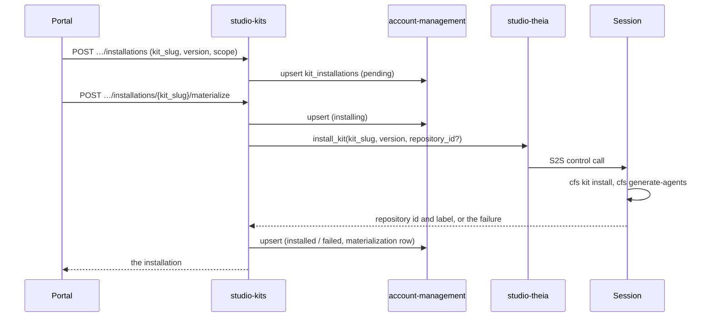

# Technical Design — studio-kits

- [x] `p3` - **ID**: `cpt-studio-design-kits`

The gear-level design of `cpt-studio-component-kits`. The product-level view,
and how this gear sits among the others, is in
[Constructor Studio's design](constructor-studio.md). The code is
[`studio-backend/src/kit_registry/`](../../studio-backend/src/kit_registry/).

## Table of Contents

- [1. Architecture Overview](#1-architecture-overview)
- [2. Principles & Constraints](#2-principles--constraints)
- [3. Technical Architecture](#3-technical-architecture)
- [4. Additional context](#4-additional-context)
- [5. Traceability](#5-traceability)

## 1. Architecture Overview

### 1.1 Architectural Vision

The catalogue of kits, and which kits a project wants installed. A kit is a
bundle of working material — templates, prompts, checklists — that a project
pulls into its checkout.

The kit's bytes stay in their canonical Git repository. A kit is already
versioned where it lives, and a second copy would be a second thing to keep
current. So this gear owns only what Git cannot answer: the catalogue metadata,
and the per-project record of which kits are desired and where they landed.
`cfs` remains the only component that materializes kit files into a checkout;
this gear says what should be there, not how it gets there.

### 1.2 Architecture Drivers

#### Functional Drivers

| Requirement | Design Response |
|-------------|------------------|
| `cpt-studio-fr-kits` | A built-in catalogue, a desired-installation document per project in account-management tenant metadata, and materialize/reconcile calls that ask the project's running session to run `cfs kit install`. |

#### NFR Allocation

| NFR ID | NFR Summary | Allocated To | Design Response | Verification Approach |
|--------|-------------|--------------|-----------------|----------------------|
| `cpt-studio-nfr-credential-isolation` | No secret in a browser | `cpt-studio-component-kits` | The install goes over the S2S-token-gated bridge; the browser never receives the bridge token and never runs kit code | `kit_registry::service` tests; `theia/studio` kit-installer tests |
| `cpt-studio-nfr-list-pagination` | One paging contract | `cpt-studio-component-kits` | Catalogue, installations and repositories take `offset`/`limit` (1..=200, default 50) and return `total` | `api_contract` drift test |

#### Key ADRs

| ADR ID | Decision Summary |
|--------|------------------|
| `cpt-studio-adr-theia-backend-bridge` | The backend reaches a session's node over the S2S bridge; materialize uses it. |
| `cpt-studio-adr-a-desktop-session-keeps-the-secrets-on-the-server` | The backend cannot call a desktop, so a desktop reports its own installs. |
| `cpt-studio-adr-the-desktop-gets-its-tools-as-extensions` | The desktop's Extensions view lists kits and reports installs to `…/materializations` (§4). |

### 1.3 Architecture Layers

| Layer | Responsibility | Technology |
|-------|---------------|------------|
| REST | Catalogue, installations, repositories, materialize, reconcile, report | `OperationBuilder` routes in `rest.rs` |
| Service | Validate, record desired state, call the session, record outcomes | `service.rs` (`KitRegistryService`) |
| Storage | One installation document per project | account-management tenant metadata |
| Runner | Run `cfs kit install` in the checkout | the session's kit installer, through `TheiaControlClientV1` |

## 2. Principles & Constraints

### 2.1 Design Principles

#### Desired state here, bytes in Git

- [x] `p2` - **ID**: `cpt-studio-principle-kits-desired-state-only`

The gear records intent (`scope`: where a kit belongs) and observation
(`materializations`: where it is, at which version). Removing an installation
deletes the desired-state entry and leaves files already in a checkout alone.

#### The runner decides what it runs

- [x] `p2` - **ID**: `cpt-studio-principle-kits-runner-validates`

Slug, version and install mode are normalized here — a slug is lowercase
letters, digits and hyphens up to 80 characters; a version is a safe Git ref up
to 120 characters with no `..`, `@{`, control characters or trailing `/` or
`.lock`; a mode is `copy` or `register`, and a GitHub kit must use `copy`. The
session's runner validates the kit and the ref again on its own allow-list and
runs `cfs` without a shell. A request cannot name an arbitrary repository URL.

#### Wider scope is asked for, never inferred

- [x] `p2` - **ID**: `cpt-studio-principle-kits-scope-opt-in`

`project` (the project repository alone) is the default; `all-repositories`
writes files into every checkout the IDE has mounted, so it has to be named.
An unknown scope read from a document narrows to the project repository rather
than widening, so a document written by a newer backend cannot make an older
one install into repositories it does not understand the intent for.

### 2.2 Constraints

#### Materializing needs a running session

- [x] `p2` - **ID**: `cpt-studio-constraint-kits-live-session`

The repository set is discovered by the IDE from the workspace on disk, so it
is only knowable while a session runs; it is not stored. `…/repositories`,
`…/materialize` and `…/reconcile` call the session and answer 503 when the
bridge is absent or no session runs, rather than an empty list that would read
as "this project has no repositories". A backend built without the
`theia-bridge` feature cannot materialize at all.

#### The catalogue is the deployment's

- [x] `p2` - **ID**: `cpt-studio-constraint-kits-static-catalogue`

`official_catalogue()` holds two kits: `sdlc`
(`constructorfabric/studio-kit-sdlc`) and `compete`
(`constructorfabric/studio-kits-pm`, a multi-kit repository whose root manifest
lists one `[[kits]]` entry per kit, so the slug names the kit and not the
repository). Each pins a default commit and the manifest path
`.cf-studio-kit.toml`. That is the default; a deployment names its own kits
in `STUDIO_KIT_CATALOGUE`, a JSON array of the same fields (see the gear's
README), read once at start; the service refuses to start when it fails to parse.
The IDE's installer keeps its own allow-list, slug to repository, so the
catalogue may drop, re-describe or re-pin those kits but not add one or move
one to another repository: such an entry is refused at start too.

## 3. Technical Architecture

### 3.1 Domain Model

- [x] `p2` - **ID**: `cpt-studio-entity-kit-installation`

A **kit** (`KitDescriptor`) is a slug, name, description, publisher,
visibility, source, repository URL, default version and manifest path. An
**installation** (`KitInstallation`) is one kit a project wants: the requested
version, source, repository URL, install mode, `status` (`pending`,
`installing`, `installed` or `failed`), who requested it and when, `scope`,
`installed_at`, `failure_reason` (cut to 2,000 characters) and its
**materializations**. A materialization is one repository the kit was written
into: repository id and label, the version actually written (which can lag the
requested one after a bump), `installed` or `failed`, when, and why it failed.

Materializations are a list because a kit is installed into a project and
materialized in repositories: the project can gain a repository after the kit
was requested, and each target carries its own version and outcome. They are
keyed by repository id — re-running an install replaces that row rather than
growing a history nobody reads.

### 3.2 Component Model

#### Kit registry service

- [x] `p2` - **ID**: `cpt-studio-component-kits-service`

##### Why this component exists

Git answers what a kit contains; something has to remember which kits a
project wants and where each one landed.

##### Responsibility scope

`service.rs`: lists the catalogue; reads and writes the project's installation
document; on request, keeps the existing `materializations` and `installed_at`
so a "Reinstall / update" does not forget where the kit already is; on
materialize, marks the row `installing`, calls the session, and records the
outcome with `record_outcome`; reconciles by materializing each repository the
scope covers that does not already carry the requested version as `installed`,
one at a time, a failure recorded on that repository's row without stopping the
rest; records a desktop's own install through the same `record_outcome`.

##### Responsibility boundaries

Writes no kit files and runs no `cfs`. A materialize failure with no named
target is recorded on the installation only, never on a guessed repository. A
document written before `materializations` existed has its single
`repository_id` promoted to one materialization on read (`upgrade_installation`)
and never written back in the old shape.

##### Related components (by ID)

- `cpt-studio-component-account-management` — owns data in (tenant metadata)
- `cpt-studio-component-theia-bridge` — calls, to list repositories and install
- `cpt-studio-component-theia-studio` — its kit installer runs `cfs`

### 3.3 API Contracts

- [x] `p2` - **ID**: `cpt-studio-interface-kits-rest`

- **Contracts**: `cpt-studio-interface-rest-api`
- **Technology**: REST/OpenAPI through `api_gateway`
- **Location**: [`studio-backend/docs/api-contract.json`](../../studio-backend/docs/api-contract.json)

**Endpoints Overview**:

| Method | Path | Description | Stability |
|--------|------|-------------|-----------|
| `GET` | `/studio-kits/v1/catalog` | Every kit of the library, each with its `shelf` (`builtin`, `official`, `organization`) and `levels`; `?shelf=` filters; `?organization_id=` adds that organization's own kits | unstable |
| `GET` | `/studio-kits/v1/catalog/{kit_slug}` | One kit and what is inside it (`contents` by the sections of a kit manifest, `manifest` = where that came from, `origin` for an organization's own kit); 404 for an unknown slug | unstable |
| `GET` | `/studio-kits/v1/organization-shelf` | The organization's own kits (`?organization_id=`), each described with its `origin`; any member | unstable |
| `POST` | `/studio-kits/v1/organization-shelf/preview` | Read a kit from a repository (`{connection_id, repository, path?, ref?, slug?}`) without keeping it; kit administrators | unstable |
| `POST` | `/studio-kits/v1/organization-shelf` | Read, pin and keep a kit on the shelf; a library slug is 400 `KIT_SLUG_TAKEN` | unstable |
| `POST` | `/studio-kits/v1/organization-shelf/{kit_slug}/refresh` | Read the kit's source again at its ref and re-pin it | unstable |
| `DELETE` | `/studio-kits/v1/organization-shelf/{kit_slug}` | Take it off the shelf; an installed kit is 400 `KIT_INSTALLED` | unstable |
| `GET` | `/studio-kits/v1/project-phase` | Project lifecycle: the project's phase and the moves open (§3.10) | unstable |
| `PUT` | `/studio-kits/v1/project-phase` | Move it along the declared lifecycle | unstable |
| `GET` | `/studio-kits/v1/project-phases` | The organization's projects with their phases | unstable |
| `GET` | `/studio-kits/v1/inbox-sources` | The Inbox sources of the kits installed for the organization (§3.11) | unstable |
| `GET` | `/studio-kits/v1/installed-kits` | The kits that apply to an organization (`?organization_id=`) or a project (`?project_id=`): `base`, `organization`, `project`, `effective` | unstable |
| `PUT` | `/studio-kits/v1/base-kits/{kit_slug}` | Install a kit for every organization (`{version?}`); platform administrators | unstable |
| `DELETE` | `/studio-kits/v1/base-kits/{kit_slug}` | Stop a kit being a base kit; a built-in kit stays removed | unstable |
| `PUT` | `/studio-kits/v1/organization-kits/{kit_slug}` | Install a kit for one organization (`?organization_id=`, `{version?}`); its administrators | unstable |
| `DELETE` | `/studio-kits/v1/organization-kits/{kit_slug}` | Uninstall the organization's own kit; a base kit is 400 `BASE_KIT` | unstable |
| `PUT` | `/studio-kits/v1/project-kits/{kit_slug}` | Install a kit for one project (`?project_id=`, `{version?}`); the organization's kit administrators; only a kit whose `levels` include `project` (`NOT_A_PROJECT_KIT`) | unstable |
| `DELETE` | `/studio-kits/v1/project-kits/{kit_slug}` | Uninstall the project's own kit; an organization or base kit is 400 `ORGANIZATION_KIT` / `BASE_KIT` | unstable |
| `GET` | `/studio-kits/v1/projects/{project_id}/installations` | What the project wants installed | unstable |
| `POST` | `/studio-kits/v1/projects/{project_id}/installations` | Request a kit (`kit_slug`, `version`, `install_mode`, `scope`); recorded as `pending` | unstable |
| `DELETE` | `/studio-kits/v1/projects/{project_id}/installations/{kit_slug}` | Stop wanting one; files in a checkout stay | unstable |
| `GET` | `/studio-kits/v1/projects/{project_id}/repositories` | The repositories the running IDE has mounted, project repository first | unstable |
| `POST` | `/studio-kits/v1/projects/{project_id}/installations/{kit_slug}/materialize` | Install it through the project's running session, into a named repository or the IDE's default | unstable |
| `POST` | `/studio-kits/v1/projects/{project_id}/installations/{kit_slug}/reconcile` | Materialize wherever the scope says it belongs; idempotent | unstable |
| `POST` | `/studio-kits/v1/projects/{project_id}/installations/{kit_slug}/materializations` | Record an install a desktop ran itself; 404 when the kit was never requested | unstable |
| `GET` | `/studio-kits/v1/mfe-manifests` | The micro-frontend packages of the kits effective in a scope (`?organization_id=` or `?project_id=`, as `installed-kits`): each package's `mfe-manifest.json` and its `base_path` (§3.12) | unstable |
| `GET` | `/studio-kits/v1/kits/{kit_slug}/{version}/mfe/{grant}/{package}/{*file}` | One file of a kit's bundle; anonymous, guarded by the `grant` (§3.12) | unstable |

A project route first resolves the project tenant under the caller's
`SecurityContext` (`get_tenant`), which delegates hierarchy authorization to
account-management, the way `cpt-studio-component-documents` authorizes its
project routes. A reported repository id or label is 1..=200 printable
characters.

### 3.4 Internal Dependencies

| Dependency Gear | Interface Used | Purpose |
|-------------------|----------------|----------|
| `account_management` | `account-management-sdk` | Resolve the project tenant; read and upsert its kit-installation metadata |
| `cpt-studio-component-theia-bridge` | `TheiaControlClientV1` from the ClientHub (`theia-bridge` feature) | `get_repositories` and `install_kit` on the project's session |

### 3.5 External Dependencies

None at runtime. The kits' Git repositories are read by `cfs` inside the
session, not by this gear.

### 3.6 Interactions & Sequences

#### Materialize a kit

**ID**: `cpt-studio-seq-kits-materialize`

**Actors**: `cpt-studio-actor-member`, `cpt-studio-actor-session`



**Description**: The request is stored first, so the row says `installing`
while the session works. A desktop runs the same install itself and posts the
outcome to `…/materializations`, which updates the same row the same way.

### 3.7 Database schemas & tables

This gear has no database. The installations of one project are one JSON
document `{ "installations": [...] }` in account-management tenant metadata
under `gts.cf.core.am.tenant_metadata.v1~cf.studio.project.kit_installations.v1~`,
sorted by kit slug. The metadata type is declared in the backend's
`config/*.yaml` with `inheritance_policy: override_only`, so a project never
inherits another tenant's list.

Installed kits (ADR-0069 §4) are one document `{ "kits": [...],
"removed_builtin": [...] }` under
`gts.cf.core.am.tenant_metadata.v1~cf.studio.kits.installed.v1~`
(`override_only`): on the platform root for the base kits, on an organization
for its own. Each record is `kit_slug`, `version`, `shelf`, `installed_by`,
`installed_at`. `removed_builtin` (root only) lists the built-in kits a
platform administrator removed; every other built-in kit is a base kit by
default. Only the gear writes the document, as its service identity, after
checking the caller (`studio_authz_plugin::GEAR_HELD_METADATA`).

### 3.8 Deployment Topology

In-process in the one `studio-backend` binary: gear `studio-kits`,
capabilities `[rest]`, deps `account_management`. Materializing needs the
`theia-bridge` feature, which the release image is built with
(`--features graph,theia-bridge`).

### 3.9 An organization's own kits

- [x] `p2` - **ID**: `cpt-studio-design-kits-organization-shelf`

ADR-0068 §4 and phase 7: an organization publishes kits for itself from a
repository it connects. The source is a repository reached through one of the
organization's **own, shared** connections (studio-connector: held by the
organization itself, not personal; the same connections the components
catalogue reads gear repositories through), a directory in it and a ref.

1. Studio pins the source: the newest commit that touched the directory on
   the ref (`GET …/commits?path=`), else the branch's head. The directory
   reads the same at that commit as at the ref.
2. It reads the manifest at that commit: `kit.json` first, else
   `.cf-studio-kit.toml` (`manifest.rs`).
3. It checks it: the slug (and that no built-in or official kit has it,
   `KIT_SLUG_TAKEN`), the name, the levels (`organization`, `workspace`,
   `project`: `platform` is the base kits'), the screens' kinds and levels,
   the functions' runtimes, distinct inbox source ids and each source's kind
   (a `query` names its type; an `endpoint` names a route of Studio's own
   that `permissions.reads` lists). Unknown keys are
   refused, so a typo is a diagnostic before anything is added.
4. It keeps the manifest as it was at the commit on the organization's
   installed-kits document (`shelf`), so describing the kit reads nothing.

**`kit.json`** is Studio's interim manifest until `kit.gdl` (ADR-0068 §3)
exists. It declares the kit (`slug`, `name`, `description`, `publisher`,
`version`, `levels`) and the sections a kit brings, under the names
`kit.gdl` will take: `screens` (`{kind: tab|section, level, label, route?,
slot?}`), `model` (the overlay, §3.10), `rules` and `services` and
`mcp_tools` (`{name, description?}`), `functions` (`{name, runtime:
wasm|agent, description?}`), `inbox` (`{id, label, kind?: query|endpoint,
query?, path?, title?, workspace_field?}`, §3.11), `permissions` (`{reads,
writes, listens}`), `material` (`{path, description?}`), `kinds`, `docs`. A
kit described only by `.cf-studio-kit.toml` brings working material: its
resources' install paths and its artifact kinds; a manifest that lists
several kits needs `slug` to say which.

The shelf is visible to that organization only: `GET /catalog` lists it
only with `organization_id`, and `GET /catalog/{kit_slug}` finds it in the
caller's (or the named) organization. Adding, refreshing and removing need
`kit.manage`. A shelf kit installs and uninstalls like any other kit, at its
pinned commit only (another version is 400: refresh moves the pin). A
refresh re-pins the shelf; an installation keeps the commit it installed
until it is installed again. The organization's metadata retains the previous
manifest while an organization installation uses it, so a shelf refresh does
not change its model overlay or remove its Inbox sources. A kit the organization has installed stays on
the shelf (`KIT_INSTALLED`). The IDE's installer does not materialize shelf
kits (it allow-lists Constructor's kits); their working material is not
written into checkouts yet.

### 3.10 A kit's model overlay

- [x] `p2` - **ID**: `cpt-studio-design-kits-model-overlay`

ADR-0067 §6, ADR-0068 phase 2: installing a kit for an organization imports
its model overlay into the organization's Studio domain model. The overlay is
`model` in the kit's `kit.json` (a built-in kit's is compiled in:
`kit_registry/builtin/<slug>.kit.json`):

```json
{
  "types": [{"name": "phase", "label": "Project phase", "description": "…",
             "extends": null, "bucket": null,
             "fields": [{"name": "order", "type": "integer"}]}],
  "fields": [{"on": "project", "name": "phase", "type": "idea | discovery | build | run"}],
  "relations": [{"on": "project", "name": "phase_of", "target": "phase", "verb": "references", "label": "in"}],
  "tabs": [{"level": "project", "name": "phases", "label": "Phases", "target": "phase"}],
  "lifecycles": [{"on": "project", "field": "phase", "states": ["idea", "discovery", "build", "run"],
                  "initial": "idea",
                  "transitions": [{"name": "discover", "from": ["idea"], "to": "discovery"}]}]
}
```

- A kit's **type** is the entity `<slug>-<name>`, catalogued as
  `gts.cf.studio.kit.<slug>.<name>.v1~` (`meta.gts`, and `types[].gts` in the
  kit's contents). The domain model derives graph types from entity ids, so
  its objects are stored under `gts.cf.studio.domain.<slug>_<name>.v1~`;
  registering the kit namespace itself as the graph type is not done.
- **A kit may declare a type Studio already has**, with `id`:
  `{"name": "milestone", "id": "milestone", "fields": [...]}`. The type
  keeps its entity id and its GTS id (`gts.cf.studio.domain.milestone.v1~`),
  so stored objects keep matching. Where the organization's model already has
  it from Studio's core, the kit adopts it instead of refusing: its other
  fields stay, a field the kit declares with the same type is taken over as
  the kit's (another type is still `KIT_MODEL_CONFLICT`), the earlier origin
  is kept in `meta.adopted_from`, and a gear's hold (`held_by` on the type and
  its fields) is kept: a gear keeps holding a type whose declaration a kit
  brings. Uninstalling removes the kit's fields; the type itself stays,
  dormant, marked `meta.left_by = {kit, version, at}` (ADR-0070 §4), while it has objects or a gear holds it. Another
  kit's type is never adopted. This is how the domain-model split (issue
  #1025) moves a core type into the kit that brings its screens (Milestone,
  Risk, Work Item, Lifecycle Stage into `project-lifecycle`; Document and
  Template into `project-specs`; …): the type leaves `ontology.studio.json`,
  and the kit's `kit.json` declares it with `id`. Nothing in this branch
  moves a type; the format and the adoption rule are what that change needs.
  One thing it must also change: `ensure_studio_types` adds Studio's own
  types back to a stored model, so a moved type has to leave that list in the
  same change.
- `on`, `target` and `level` name a type of the model by id, or one of the
  kit's own by name. A `tab` is a `shows` relation (ADR-0066).
- Everything is marked `origin = "kit"`, `kit = <slug>`, `kit_version`: on
  the type's `meta`, on each property, on each `meta.lifecycles[]` entry.
- The rules of ADR-0067 §6: the format has no way to remove or retype; a
  field, relation or tab a type already has from anybody else (Studio, a
  gear, an administrator, another kit) refuses the install with 400
  `failed_precondition` `KIT_MODEL_CONFLICT`, and nothing is recorded; there
  is no `held_by` to say (unknown keys are refused), so a kit never holds a
  type.
- **Install** applies the overlay before the installation is recorded.
  **Uninstall** removes what carries the kit's origin; a kit type that still
  has objects is kept with its fields, dormant, marked `meta.left_by = {kit, version, at}` (ADR-0070 §4), until an
  administrator removes it, and a later install takes it back. **Upgrade**
  (installing another version) applies the difference: what the new version
  no longer has goes, what changed is replaced, what is new is added. Each is
  one numbered, revertible model version (`op = "kit"`) whose patch names only
  the types it touched.
- It goes through the domain model's port
  (`DomainObjects::sync_kit_model`, `kit_models`), as this gear's service
  identity in the organization, after the installer checked the caller.
- Lifecycles are **declared** in the model (`meta.lifecycles`), not yet
  enforced by `/mutate` (ADR-0067 phase 3 is not built). Project lifecycle's
  function enforces its own (below).

Current implementation (2026-11-10; the layered replacement is required by ADR-0070):

1. **Copied, not layered.** A kit's overlay is written into each
   organization's stored model, marked with its origin. A layered effective
   model — core seed, then base kits' overlays, then the organization's kits',
   then its own edits — would keep overlays out of the stored documents, but
   the domain model stores one whole document per organization and every
   write path depends on that: field edits address properties by index, a
   version's patch and its inverse are JSON Patch over that document, revert
   replays inverses on it, and the read model and graph registration read the
   document. Layering means keeping an organization's edits as a patch set
   over a computed base, and re-deriving all of those; that is a change of
   the domain model's storage, not of the installer. The least copying that
   works: a **base kit** reaches an organization's model when that
   organization's installed kits are next read (`GET /installed-kits`, which
   the shell reads on entering an organization, and the phase routes), not by
   a sweep over every organization, so an organization nobody opens is not
   written. Organizations created later get the base kits' overlays on their
   first read the same way. An organization's own install or uninstall is
   applied at once.
2. **A kit that brings a model is not installed for one project.** The model
   is the organization's (ADR-0067 §6, ADR-0068 §5). `PUT /project-kits/…`
   refuses it with 400 `failed_precondition` `MODEL_KIT_NOT_FOR_PROJECT`;
   install it for the organization. (Applying it at the organization level
   from a project's install would change every project's model silently.)
3. **Core changes after the first store.** Studio's own types now compose as
   a pinned core layer under the organization's overrides
   (`studio-domain-model.md`, "The running core as a layer"): a changed core
   field reaches every organization that did not change it. Kit types still
   compose as copies with pinned property layers.

**Against ADR-0070** (Studio keeps a core model, each kit brings its types;
decided after this was built). What already matches: the marks
(`meta.origin = "kit"`, `meta.kit`, `meta.kit_version`, which Admin › Studio
domain model reads); the dormant mark `meta.left_by = {kit, version, at}` on a
type that has objects or that a gear holds, and on its fields; declaring an
existing type with its own ids; a gear's `held_by` kept under a kit's
declaration. What this installer does differently, to be changed by
ADR-0070's phases:

- The overlay is copied into the stored model (decision 1) where ADR-0070 §5
  computes the effective model in layers. Every element a kit brought carries
  its marks, so the migration's split (`organization layer = stored model −
  (core ⊕ gears ⊕ base kits)`) can take the copies back out.
- Kit-contributed properties and lifecycles now have pinned source records and
  named organization overrides/tombstones (`kit_property_layers`). Once the
  source is known, upgrades and reinstalls preserve removals and partial edits.
  Same-version reconciliation adopts a known legacy source; a different unknown
  historical source is refused rather than inferred. Studio's own types have
  the same treatment at type and field level (`core_layer`), with a one-way
  migration and its equality check; kit types' entity attributes remain
  (#1032, with #1000).
- Dormant is a mark only: the domain model does not yet refuse writes
  (`DOMAIN_TYPE_DORMANT`) or hide a dormant type from members
  (`DOMAIN_TYPE_NOT_INSTALLED`), and screens are not told.
- A field a kit added to another type, or that an upgrade drops, is taken out
  of the model (its values stay in the objects' payloads) rather than kept
  dormant; only the fields of a kept kit type stay, marked.
- A gear's `ensure_type` stores explicit `gear_declarations` separately and
  projects additive storage needs. A missing type is `origin: gear`, not
  `studio`, and does not install its owning kit. The held/dormant projection is
  retained; state-based member visibility is still phase 4.

**Project lifecycle** is the first built-in kit that brings a model: the type
`project-lifecycle-phase`, the fields `project.phase`
(`idea | discovery | build | run`), `project.phase_owner` and
`project.phase_since`, the tab `project.phases`, and the phase lifecycle
(idea → discovery → build → run, back from discovery or build to idea and
from run to build). Until kit functions run in Studio's function runtime
(ADR-0068 §9), its function is compiled into this gear (`phase.rs`):

| Method | Path | Who |
| --- | --- | --- |
| `GET` | `/studio-kits/v1/project-phase` | any member: `{installed, phase, phase_owner, phase_since, states, next[]}` |
| `PUT` | `/studio-kits/v1/project-phase` | `{phase, owner?}`, only along a declared transition (`NO_SUCH_TRANSITION`); written as the caller, so the PDP's `domain.edit` decides (403 `DOMAIN_EDIT_REQUIRED`); `KIT_NOT_INSTALLED` where the kit does not apply |
| `GET` | `/studio-kits/v1/project-phases?organization_id=` | any member: the organization's projects with a phase |

MCP: `project_phase`, `project_phase_set`, `project_phases`.

### 3.11 Inbox sources from kits

- [x] `p2` - **ID**: `cpt-studio-design-kits-inbox-sources`

ADR-0068 §6, phase 4: the Inbox holds no items of its own; a kit may declare
sources, of three kinds (`kind`, default `query`):

- **`query`**, `{id, label, kind?: "query", query, title?, workspace_field?}`:
  `query` is the body `POST /studio-domain-model/v1/query` takes, over the
  kit's objects, with the string `"$me"` standing for the person whose Inbox
  is read; `title` names an item (`{field}` is a field of the row, the label
  when absent); `workspace_field` is the row's field holding its workspace.
- **`endpoint`**, `{id, label, kind: "endpoint", path, title?}`: for what a
  kit wants to say from records that are not domain objects (a deploy, a
  sign-in). `path` is a gear's own route, `GET`, literal (`/studio-<gear>/v1/…`,
  no query string, parameter, `..` or empty segment, at most 200 characters),
  and the kit's `permissions.reads` must name it as `GET <path>`, so the
  administrator saw it before installing. The route is called **as the
  person** and answers the list envelope `{items, total}`; each item has an
  `id` (a string or a number, stable within the source; an item without one
  is left out) and may have `title`, `workspace_id`, `url`, `due_at`
  (RFC 3339) and `overdue`, and any other field a `title` template names. The
  title is the source's `title` filled from the item, else the item's own
  `title`, else the source's label. The route decides whom an item waits on
  and where the kit applies. A `query` source has no `path`; an `endpoint`
  source has no `query` or `workspace_field`.
- **`studio`**, `{id, label, kind: "studio"}`: one of the two sources
  studio-user's Inbox reads itself — `review-requests` (studio-documents, a
  review waiting on the person's verdict) and `pull-requests` (studio-artifact-
  ingest, a pull request whose next step is theirs) — which a built-in kit
  owns: project-specs declares the first, project-git the second (ADR-0070 §7).
  It names no `query`, `path`, `title` or `workspace_field`; its `id` is one of
  the two. It is listed only while its kit is installed for the whole
  organization (a base kit or its own; a project's own installation does not
  count, because the Inbox reads by workspace), and only from a built-in kit:
  one in an organization's shelf kit brings nothing. Without the kit the Inbox
  reads no such items. Its items keep their `source`, key and record; they
  carry the kit. When the kits' sources cannot be read, both are read as the
  shell's, and `unread` says so.

Any other `kind` is refused.

Either kind may name its **`destination`** (ADR-0068 §6, "which tool answers
it"): `{route?, mcp_tool?}`, the kit's screen that answers an item (one of its
`screens[].route`) and the kit's MCP tool that acts on it (one of its
`mcp_tools`), both checked when the manifest is read. `/inbox-sources` and
each Inbox item carry it; without one an item opens the kit's workspace.

A screen may say which domain types another kit brings it shows,
`screens[].needs` (`["milestone"]` for Project activity's Timeline): the kit's
detail lists it, and the shell hides the screen where one is not installed.

`GET /studio-user/v1/me/inbox?organization_id=` reads the organization on
screen (its workspaces through `/rollups?organization_id=`, its kits' sources
with the same scope); without it, the caller's home. Beside the sources it
answers `members_known` (whether pull requests' accounts were matched to
members) and `workspaces` (how many were read), and the shell's own
`failed-runs` source: the person's background runs that failed in the last 7
days (studio-tasks), an undelivered notification among them. Deploys waiting
for a decision are answered by
`GET /studio-environments/v1/inbox/deploys-awaiting-approval` (an `endpoint`
source for the Releases kit's manifest to declare).

`GET /studio-kits/v1/inbox-sources?organization_id=` (any member) lists the
sources of the kits installed for the whole organization (base kits and its
own; not a project's own `query` sources: those would need the project's PDP
scope), at the version installed, each with its kit's slug, name and version,
its `kind` and its `query` or `path`; the kits' models are brought up to date
first, so the fields a source queries exist. A built-in kit that may be
installed for one project (`levels` names `project`) brings its `endpoint`
sources to every organization: this gear cannot list the projects that have
it, and its route answers only for those. studio-user's
`GET /studio-user/v1/me/inbox` reads that list and reads each source **as the
person**: a `query` source with `"$me"` their subject id (so the PDP decides
what each person sees), an `endpoint` source by calling its route (checked
again to be a route of Studio's own before it is called with the person's
token). It adds the rows as items after its own sources:
`source = kit:<slug>/<id>`, `kit = {slug, name, version}`, the key
`kit:<slug>/<id>:<object or item id>@<fingerprint of the row or item>` (an
item marked done comes back when it changes), done and snooze as for any
item. A source that cannot be read is named in `unread`. MCP:
`kits_inbox_sources`; `me_inbox` carries the kits' items.

Project lifecycle brings one: `phase-waiting`, a project whose
`phase_owner` is the person and whose phase is not `run` — "*Atlas* waits in
its *discovery* phase". Constructor Research brings two `endpoint` sources
(§3.13): a failed Research deploy and a Research sign-in that runs out.

Kit bundles (§3.12) are read from `STUDIO_KIT_BUNDLES_DIR` when it is set; a
deployment with several backend replicas sets `STUDIO_KIT_BUNDLE_KEY` (at
least 16 characters) so that every replica signs the same grants.

### 3.12 Kit micro-frontends at run time

ADR-0068 phase 5: a kit's screens are FrontX micro-frontends the shell loads
when the kit applies, so a new kit needs no portal rebuild. The built-in kits
stay in the portal's build (`generated-mfe-manifests.json`).

**The bundle.** A kit's `kit.gdl` (GDL 1.7) names its bundles,
`mfe = [path("mfe/<package>")]`, and `levels`. Each `mfe/<package>/` is what
`vite build` with Module Federation and the `frontxMfGts` plugin writes:
`mfe-manifest.json` (the FrontX manifest, entries, extensions, schemas — the
same file the portal's build-time generator reads), `remoteEntry.js`,
`assets/…` and `shared/…`. The passport is read by the same literal-only
reader as every `kit.gdl` (`components_catalog/kit_gdl.rs`); `path("…")` reads
as the string it names.

**Where the bytes come from.** A `BundleSource` (`bundles.rs`). Today:
`DirSource`, the directory `STUDIO_KIT_BUNDLES_DIR`, each subdirectory with a
`kit.gdl` that names bundles being one kit at the version it states. Those
kits join the library on the `organization` shelf with `source = bundle-dir`
(never the IDE's `official` list, and never a slug the library already holds),
so they are installed like any other kit. The second source is the
organization shelf (`shelf_bundles.rs`, ADR-0068 phase 7): a shelf kit's
`kit.json` names its bundles (`"mfe": ["mfe/<package>"]`, directories beside
the manifest), and they are read through the organization's own connection at
the commit the kit is pinned to. A package is served only at the version its
source built; an installation at another version lists nothing.

**What the shell is told.** `GET /mfe-manifests` resolves the scope exactly as
`GET /installed-kits` does and lists, for each effective kit with bundles at
its installed version, each package: `kit_slug`, `version`, `package`,
`base_path` = `/cf/studio-kits/v1/kits/{slug}/{version}/mfe/{grant}/{package}/`
(for a shelf kit `version` is the pinned commit and `grant` names the organization)
and `config` (its `mfe-manifest.json`), or `config: null` with `error` when it
does not read (not built, not JSON, not a FrontX build).

**The shell** (`studio-frontend-prototype/src-app/app/mfe/runtimeKits.ts`,
`layout/RuntimeKits.tsx`) reads the list after the installed kits, and again
whenever their slugs or versions change, turns each package into the config
the build-time generator would write (the public path from `base_path`, the
manifest inlined into each entry) and registers it into the same registry
through the same `registerMfePackage`: GTS validation, levels, placement,
order and the `kit` gate apply alike. A runtime package may not own a domain,
carry a frame entry, reuse an extension id, a route or a GTS package
(`vendor.package`) a built-in screen has, or redefine a schema the type system
already knows (its own unchanged schemas survive an upgrade); its extensions' `presentation.kit` is always its own slug. A
package refused, not readable, or whose screen does not mount is a tile above
the screen that the person can dismiss; the rest of the shell goes on.

**The lifecycle in the shell** (issue #1006).
- *Desired state.* The list for a scope is what the registry holds for it: a
  package listed at a new revision (its `version` or its `base_path`) replaces
  its registration; a package no longer listed — uninstalled, or not installed
  where the person moved — is unregistered, and the FrontX runtime releases
  whatever of it was mounted. The shell treats `base_path` as opaque, so a
  source that pins a commit into the path makes a re-pin a new revision.
- *Upgrade without a reload.* FrontX's module handler keeps every loaded
  remote for the page's life, keyed by extension id. When an extension comes
  back at another revision the shell forgets that load
  (`mfe/remoteCache.ts`; mfes 0.4 has no public eviction, so it reads the
  handler's private cache and does nothing if it is not there) and the next
  mount loads the new bundle; the screen on display is mounted again.
- *Cold deep links.* Routing starts before the kits' packages are registered.
  An address no registered screen answers to keeps its place: its
  organization, workspace and project are applied, and it waits while the
  loader has `begin`-ed the scope and not yet `settle`-d it (settled after
  `sync`, or when either read fails; at most 20 s). Each registration change
  re-reads the screen groups and applies the address again, so the kit's
  screen opens; when the scope settles without it the screen area says it is
  not available here (naming the kit when it had been loaded in this page) and
  offers the level's home. A screen whose kit is uninstalled while on display
  ends in the same state.
- *Live.* The installed kits are read again on a `kit.*` studio event
  (`kit.installed` / `kit.uninstalled`, published by the installer on the
  organization's channel; a base kit's on the platform's) or
  `domain.model_changed`.

**Slots.** ADR-0068 §2's `section in a screen`: a kit contributes into a named
slot the shell owns, never into a domain of its own (a package naming a domain
the shell has not registered is refused). Each slot is a FrontX extension
domain with the concurrent mount strategy
(`studio-frontend-prototype/src-app/app/mfe/slots.ts`); a contribution is an
extension of `gts.frontx.mfes.ext.extension.v1~constructor_studio.shell.slots.contribution.v1~`
whose `presentation` carries `label`, `order` (ascending, then id), `kit`
(set by the shell for a runtime package), and optionally `level` and `screen`
(the route of the item it goes with). A slot passes theme, language,
organization, workspace, project, section, the person and the last studio
event. Each contribution mounts on its own action chain into its own shadow
root; one that fails is a small note in its place and on the kit's tile, and
is tried again only when its registration changes.

| Slot | Domain | Drawn |
|---|---|---|
| `project.header.status` | `…shell.slots.project_header_status.v1` | beside the open project in the path bar |
| `screen.toolbar.actions` | `…shell.slots.screen_toolbar_actions.v1` | at the end of the level's tab row |
| `screen.panels` | `…shell.slots.screen_panels.v1` | above the screen, e.g. `screen = "/projects/overview"` |

`examples/kits/hello-kit` contributes a panel to Project › Overview and a
status chip. A slot inside a micro-frontend's own page is not offered: the
screen would have to host a domain in its shadow root.

**Repository-backed bundles** (issue #1045).
1. *Which bundles.* `kit.json` names them: `"mfe": ["mfe/<package>"]`, as
   `kit.gdl`'s `mfe = [path(...)]`, at most 16, checked when the kit is added.
2. *Whose kit.* A shelf kit's installed version is its pinned commit, and one
   slug can sit on two organizations' shelves, so a `BundleSource` says
   whether it is `per_organization`; such a kit's grant is the organization
   (32 hex digits) followed by an HMAC over the organization, the slug and the
   commit, and the same file route reads the organization back from it. The shelf resolves (organization,
   slug, commit) to the `KitOrigin` (connection, repository, directory),
   from the current shelf entry or one kept for an installation after a
   refresh.
3. *Reading.* `KitSourceReader::read_file` reads a file's bytes at the commit
   through the organization's own shared connection (the same checks as
   adding the kit), as the gear's service identity in the organization: the
   grant proves a member was shown the kit. Files at a commit are immutable,
   so they are kept in memory keyed by connection, repository, commit and
   path, up to 64 MiB (oldest out; a missing file is remembered too), and
   served with `immutable` caching. At most 16 MiB a file, as `DirSource`.
4. The shell needs no change: it uses `base_path` as given and keys a
   registration's revision on it, so a re-pin is a new revision.

**Security.**
- The shell's module loader (`MfeHandlerMF`) fetches a bundle's files itself,
  with no token, so the file route is anonymous (like a person's photo in
  `studio-user`). Its guard is `grant`: HMAC-SHA-256 over the slug and version,
  keyed by `STUDIO_KIT_BUNDLE_KEY` or a key drawn at start, learned only from
  `GET /mfe-manifests`, which answers only a member of the scope and only for
  kits effective there. A wrong grant is the same 404 as a missing file.
  Uninstalling removes the kit from the list; a grant already learned stays
  valid for that version until the key changes, as a cached bundle would.
- Only a bundle's own types are served (scripts, styles, JSON and source maps,
  images, fonts, wasm, text), each with its content type,
  `X-Content-Type-Options: nosniff`, `Cross-Origin-Resource-Policy:
  same-origin` and `Content-Security-Policy: default-src 'none'; sandbox`.
  Never an HTML page, a hidden file (`.vite/…`), a path with `..` or one whose
  real location (after links) is outside the package; at most 16 MiB a file.
- Same origin: the shell loads them through the gateway (`/cf/…`), so neither
  the portal's nginx nor the browser needs another origin allowed.
- Content Security Policy: the portal sets none today
  (`studio-frontend-prototype/nginx.conf.template`). One that is added must
  keep `script-src 'self' blob:` (the loader evaluates every chunk, built-in
  or kit, from a `blob:` URL after rewriting its imports), `style-src 'self'
  'unsafe-inline'` (each screen's styles go into its shadow root) and
  `connect-src 'self'` (the chunks are fetched). A kit adds nothing to that.
- A kit's code runs in the portal's origin with the person's session, as a
  built-in screen does: installing a kit is trusting its publisher. The library
  shows who that is; signed kits are ADR-0068 phase 9.

### 3.13 The Constructor Research kit

- [ ] `p2` - **ID**: `cpt-studio-design-kits-constructor-research`

A kit an organization, or one project, installs to build a product in
Constructor Research and run it as one of Research's applications
(`cpt-studio-adr-research-environments`, ADR-0049). The machinery is
studio-environments' and studio-connector's and stays there: the `research`
connection and its sign-in (ADR-0049 §1), `kind: research` environments on a
Research project (§2), the build Studio prepares and Research compiles (§3),
the deploy as an application of services, status, logs, rollback and
uninstall (§4). The kit is what switches it on, the screen that walks an
organization there, and the Inbox items that say when something there waits
on a person (ADR-0068 §1: a feature that only some organizations need is a
kit's).

It is not ADR-0068 §7's "Research" built-in kit: that row is the portal's
Research tab, discovery research (hypotheses and interviews), a different
thing with a different future kit. This one is named after the product it
integrates with.

**Where it sits.** Slug `constructor-research`, name "Constructor Research",
shelf `builtin`, levels `organization` and `project`. It is the first
**opt-in built-in kit** (`OPT_IN_BUILTIN` in `service.rs`): compiled in like
every built-in kit, but not a base kit by default (ADR-0068 §7, "installed only
where someone asks for them"). An organization's administrator installs it
under Organization › Kits, or for one project under Project › Kits (it brings
no model, so `MODEL_KIT_NOT_FOR_PROJECT` does not apply); a platform
administrator may make it a base kit for everyone, and removing that record
leaves nothing marked removed. It needs no other kit; its screen's links into
Infrastructure and Releases lead nowhere when those base kits are removed.
Its compiled-in `kit.json` is `kit_registry/builtin/constructor-research.kit.json`.

**What it brings** (`GET /studio-kits/v1/catalog/constructor-research`):

| Part | What | Where |
|---|---|---|
| tab | Organization › Constructor Research (`/constructor-research`): the member's own sign-in, the steps sign in → connect a Research project → build and deploy from Releases, and each Research environment with its project and hardware, Test, Change and what each project runs there (status, logs, address) | `infrastructure-mfe`, second entry `./researchLifecycle` |
| function | the gate: studio-environments asks studio-kits (`KitPresence`) before it adds or changes a Research environment, lists a connection's Research projects or hardware, or starts a build, deploy or rollback to Research; without the kit, 400 `failed_precondition` `KIT_NOT_INSTALLED` naming the kit | `environments/service.rs` `require_research_kit` |
| inbox-source | `deploy-failed` and `sign-in-expires`, both of kind `endpoint` (§3.11) | `GET /studio-environments/v1/research/inbox/deploys`, `…/research/inbox/sign-in` |
| mcp-tool | `research_projects`, `research_hardware`; the build and deploy themselves are `build_start` and `deploy_request` on a Research environment | `environments/mcp.rs` |
| permissions | the routes its screen and its Inbox sources call (`contents.rs`, `kit.json`) | |

**Where the gate looks.** A request about a project -- a build, a deploy, a
rollback, the project's own Research environment -- asks the project's
effective kits: base ∪ organization ∪ the project's own. A request about the
organization's own environments -- adding or changing one, listing a
connection's Research projects and hardware for that form -- asks the
organization's: base ∪ its own. So a project that installed the kit alone
builds and deploys to Research, also on the organization's Research
environments, while the organization's Constructor Research tab stays hidden
and its administrators cannot add a Research environment for everyone.

**Inbox.**

- `deploy-failed`: each Research deploy the person asked for whose newest
  attempt in its environment failed, newest first, in the projects where the
  kit applies; the title names the project and environment, `detail` says why.
  It leaves when a newer deploy there succeeds (or is marked done; a newer
  failure is a new item).
- `sign-in-expires`: the person's own Research sign-in when its access key
  runs out within 14 days or has run out. The key lasts 90 days from the
  sign-in (ADR-0049 §1), so the end is the connection's `created_at` plus 90
  days; a connection made before the keys (a refresh token) is read the same
  way, which warns it early rather than never. Shown where the kit is in use:
  it applies to the organization, or to a project the person deployed to
  Research.

No types: a Research environment, a build and a deploy are
studio-environments' records, not domain objects (ADR-0070 §1, a kit that
brings only screens) -- which is why its Inbox sources are `endpoint` ones.

**Uninstalling** removes the tab, closes the gate and empties its Inbox
items. Nothing stored moves: Research environments stay in the organization's
list (Infrastructure and Releases still show them), and status, logs, an
uninstall of what runs there and removing the environment stay possible, so an
organization can take its applications out of Research after it removed the
kit. Reinstalling opens the gate on the same environments.

**Not yet**, each for its own change:

- The Research parts of Infrastructure (the Research place, its form fields)
  and of Releases (a Research rung's sign-in and limits) as sections of this
  kit in those screens' slots: sections in another screen's slot are not
  built yet (§3.12). Until then Infrastructure reads `GET /installed-kits` and
  its "Add a place › Constructor Research" opens Organization › Kits where the
  kit is missing.
- A project-level screen: a project that installed the kit alone uses its
  Releases; the Constructor Research tab is the organization's.
- Listing Research projects for a project's own Research environment: the
  listing asks the organization's kits, so a project-only installation types
  the Research project's id.

## 4. Additional context

[`docs/kit-registry-prototype.md`](../kit-registry-prototype.md) is the
prototype slice: the user flow in `studio-frontend-prototype`, the installation
boundary inside the session, and how the session image pins `cfs`.

## 5. Traceability

- **PRD**: [Constructor Studio](../prd/constructor-studio.md)
- **Design**: [Constructor Studio](constructor-studio.md)
- **ADRs**: [ADR index](../adr/README.md)
- **Code**: [`studio-backend/src/kit_registry/`](../../studio-backend/src/kit_registry/)
