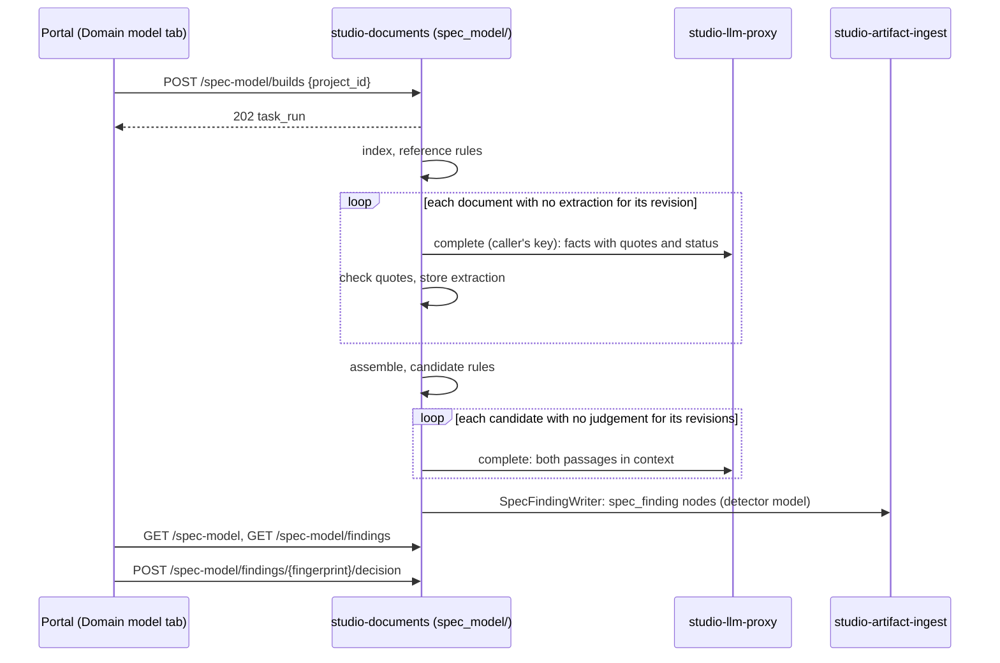

# A project's domain model, read from its documents

What Studio reads out of a project's documentation about the application it
describes, how it finds where the documents disagree about it, and where that
lives in the code.

Status: proposal, 2026-10-12. It is part of
[studio-documents](design/studio-documents.md), the gear that already owns the
document index, the analysis on sync and the findings, as the module
`studio-backend/src/documents/spec_model/`. Requirements:
`cpt-studio-fr-spec-domain-model` and `cpt-studio-fr-spec-contradictions` in the
[PRD](prd/constructor-studio.md).

## Why this exists

A project's documentation describes an application that does not exist yet.
Spread over its PRDs, designs, decompositions and ADRs is that application's
domain model: what it is made of (entities, their attributes and relations),
what it has to do (requirements) and what must always hold (constraints,
lifecycles, access rules, decisions). Nobody writes this model down in one
place, so nobody sees where the documents disagree about it, and a
disagreement is found when someone builds one side of it.

Studio reads the model out of the documents as they are written and keeps it
per project, every fact with the passage it comes from and whether that passage
is in force. Then it checks the model for the problems a person would want to
fix: two documents that cannot both be right, a document still describing what
a later decision replaced, a reference to something that does not exist. Each
problem is a finding with both passages, an explanation and the smallest edit
that fixes it, or the decision a person has to take when the documents cannot
tell which side is right.

The goal is not a better-written specification. Judging a document's form is
the Spec Quality detectors' job ([spec-findings.md](spec-findings.md)). This
finds precise, fixable disagreements about the product, and stays quiet about
everything else.

## Principles

**Read as written, fix what is wrong.** Building the model asks nothing of the
documents: no front matter, no template, no annotations
(`cpt-studio-principle-spec-mapping-as-written`). The same mechanism runs on
every project; nothing in the prompts, rules or code names a product, a
repository, a document path or a domain term. What it proposes to change is
only what is wrong about the product, each in one edit: never a missing
section, a style, or "could be clearer".

**Every fact has a passage and a status.** A fact without its passage cannot be
argued with, and a fact without its status makes every deferred section look
like a contradiction. So every fact carries:
- **where**: path, line range and the verbatim quote. The quote is checked
  mechanically against the document revision it was extracted from; a quote
  not found there, whitespace collapsed, drops the fact;
- **status**: `active`; `proposed` (from a proposed ADR with no sign of being
  built, or a requirement the text marks as such); `deferred` ("future",
  "planned", "out of this release", "known gap"); `superseded` (the text, or a
  later decision, says it was replaced); `resolved` (an open question the text
  closes elsewhere); or `evidence` (research notes, audits, examples, an ADR's
  Context, a component's "why it exists": what someone found or what was
  true before, not what the product must do). The words that gave the status
  are kept with it.

Status belongs to a clause, not a block: "Planned. … returns nothing today"
holds a deferred plan and an active statement about now. And a proposed ADR is
not always unbuilt: a team may leave records `proposed` after shipping them,
so an ADR whose own text says "Built", "Implemented in" or "done in #N" counts
as in force for those parts. Supersession is read from the later record
("Supersedes", "Amends", "retired by"), not from an index's status column,
which drifts.

A finding is only ever raised between `active` facts, or between an `active`
fact and the `active` decision that replaced it.

**The model is the unit, not the document.** Most of what is worth finding sits
on a seam between documents: the domain's PRD against a component's design, an
ADR against the design that cites it, a decomposition against the PRD it
decomposes. A check that reads one document cannot see them. So facts are
merged across the project before any rule runs: one entity mentioned in five
documents is one entity with five sources, and two statements about the same
aspect of it are compared wherever they are.

**Rules propose, a model confirms, a person decides.** Finding a candidate is
deterministic: two `active` facts on the same entity and aspect with different
values; an `active` statement that a `proposed` decision is in force; an
identifier referenced and defined nowhere. A candidate becomes a finding only
when the judge, shown both passages with their surrounding section, agrees they
cannot both hold, says why in a sentence or two and proposes the fix. A member
then marks the finding ✓ (a real problem) or ✗ (not one); the decision is kept
for as long as the finding keeps appearing.

**Quiet beats complete.** A finding a reviewer dismisses costs more than a
finding never raised, because it teaches people to ignore the list. Rules that
produced noise on real documentation are not run (see
[the catalogue](#the-rule-catalogue)), and a rule joins the catalogue only after
it has been calibrated on at least two unrelated projects.

## Constraints

**A person's key, never Studio's.** Extraction and judging call a model through
`llm_proxy::port::ModelProviders::complete` on the key of the member who
started the build (ADR-0039): Studio holds no key of its own. A source sync
therefore refreshes only the deterministic index and marks the model stale; the
model calls run when a member builds it. A member with no key is told so, and
the index's findings (references) are still shown.

**Results are tied to revisions.** Model answers are not deterministic. An
extraction is stored per (project, path, content revision, extractor version)
and a judgement per (rule, fingerprint, the revisions of every side, judge
version). An unchanged document is never extracted again, so the model does not
change between two builds of the same text, and a finding missing from a
rebuild is resolved only when the text of one of its sides changed.

## The model

- **Source document**: a typed document of the project (repository binding or
  Studio document), with its kind (`spec` or `evidence`), its path and its
  content revision, as the documents index already holds it.
- **Reference index**: every identifier the project's documents define and
  where (a requirement or component id, a heading anchor, an ADR); every
  reference to one; every link. ADRs are indexed with their **namespace** (the
  directory they live in), number, title and status, read from front matter, a
  `Status:` line or an inline note, because one project can number two ADR sets
  from 0001.
- **Fact**: `{kind, subject, aspect?, value?, text, status, status_because?,
  sources[]}`, with `kind` one of `entity`, `attribute`, `relation`,
  `requirement`, `constraint`, `lifecycle`, `decision`. `subject` is the entity
  (or decision) it is about; `aspect` is the slot a value fills, named by the
  extractor in plain words (grain, trigger, dating rule, routing, cardinality,
  who may read, limit). Every source is `{path, line_start, line_end, quote,
  revision}`.
- **Entity**: a merged subject: its name, its aliases, its definition and the
  facts about it. Implicit entities count: a thing never declared but used as a
  key or a grain ("one row per connector instance") is an entity.
- **Candidate**: a rule, the facts on its sides, and its fingerprint (the rule
  and every side's path and normalised quote; never line numbers).
- **Finding**: the shape the spec-findings pipeline already reads
  ([the finding](spec-findings.md#the-finding)) with `detector: "model"`:
  `rule`, `severity`, `message` (the judge's explanation), `anchor` (side A),
  `related` (the other sides), `fix` (`{path, replace, with}` or `{decide: [A,
  B]}`), `confidence`.
- **Finding decision**: (project, fingerprint) → `confirmed` or `dismissed`,
  with who, when and the revisions decided against.

## A build

One `documents.spec_model_build` run on studio-tasks, under the security context of
the member who started it, in stages:

1. **Index** (no model). Lists the project's typed documents and their
   revisions; builds the reference index; runs the reference rules.
2. **Extract** (model, per changed document). Reads a document section by
   section and asks for its facts in the schema above, with status and
   verbatim quotes; checks every quote; stores the extraction for that
   revision. The prompt is the same for every project.
3. **Assemble** (no model). Merges subjects by normalised name and aliases
   across documents; applies decision status (a fact resting on a proposed ADR
   with no sign of being built is `proposed`; a superseded ADR's facts are
   `superseded`); groups facts by (subject, aspect).
4. **Candidates** (no model). Runs the rules of the catalogue over the
   assembled model.
5. **Judge** (model, per new candidate). Shows both passages with their whole
   section and both documents' status notes; keeps the candidate only on a
   confirmed conflict, with the explanation and the fix; stores the judgement
   for those revisions.
6. **Record.** Writes the findings as `spec_finding` nodes through
   `artifact_ingest::port::SpecFindingWriter` (one per document with findings,
   other sides in `related`), so the Specs list counts them and the IDE's
   Quality rail shows them in the text.

In the code, under `studio-backend/src/documents/spec_model/`: `index.rs`,
`extract.rs`, `assemble.rs`, `rules.rs` and `judge.rs`, the first, third and
fourth pure functions; `build_task.rs` for the run; the routes in the gear's
`rest.rs`. The text is read through `artifact_ingest::port::RepoFileReader`, as
classification already reads it.

**Built so far:** stage 1. `index.rs` and `finding.rs`, served by
`GET /spec-model/findings?project_id=`, computed on read (it is cheap and needs
no key). The reference rules, as built:
- an identifier is checked only in a family (the first two segments, as in `cpt-…`) the project defines
  at least five of, with the kit's defining labels `**ID**:` and `**Contract**:`;
- an ADR number is checked only when the project has ADRs, and resolved to the
  nearest ADR directory; a tie is `reference.ambiguous`;
- a link is checked against every file of the project's checkouts, and an
  anchor against the target's headings and explicit ids, compared with
  everything but letters and digits removed, because renderers slug headings
  differently and a link is not broken on the renderer it was written for;
- a line naming what something used to be called ("formerly", "renamed") is
  history and is not resolved;
- one missing thing is one finding with every place that cites it, and its
  fingerprint is the thing alone.

## The rule catalogue

Calibrated on real documentation ([calibration](#calibration)). **Run:**

| Rule | Finds | Stage | Severity |
|---|---|---|---|
| `reference.dangling` | An identifier, ADR or file referenced and defined nowhere in the project | index | high |
| `reference.ambiguous` | A bare ADR number that two namespaces of the project both have, cited from outside both | index | medium |
| `reference.misattributed` | A citation whose stated purpose does not match the cited ADR's title and decision | judge | high |
| `contradiction.value` | Two `active` facts give one aspect of one subject different values (an enum, a number, a routing, a shape, a percentile), including a stated count against the list it counts ("five tables" beside six); only an explicit count or a closed list, never "used by" or a parenthetical example | rules + judge | high |
| `contradiction.cardinality` | One row or object per A in one place, per B in another | rules + judge | high |
| `contradiction.lifecycle` | Who or what starts, dates, ends or re-runs something, stated two ways | rules + judge | high |
| `contradiction.access` | Who may read or write, or whether a check runs, stated two ways | rules + judge | high |
| `contradiction.decision` | Text against an `active` decision, or text treating as made a `proposed` decision with no sign of being built | rules + judge | high |
| `stale.superseded` | `active` text describing what a later decision or section replaced | rules + judge | medium, marked "check" |

**Not run**, and why:
- `term.synonym_drift`: every candidate in calibration was a deliberate rename
  between layers, except an identifier used for two things, which
  `reference.ambiguous` already catches;
- `term.undefined`, `requirement.orphan`, `constraint.vague`: nothing they
  raised survived review;
- `formula.mismatch`: real, but needs a table of what each quantity is called
  in each layer first; a later rule.

## REST

Under `/studio-documents/v1`, beside the gear's other routes:

| Method | Path | Description |
|--------|------|-------------|
| `POST` | `/spec-model/builds` | Build a project's model on the caller's key: `202` with the `task_run` to follow |
| `GET` | `/spec-model?project_id=` | The assembled model: entities with their facts and sources, requirements, constraints, decisions; whether it is stale and which documents are not extracted yet |
| `GET` | `/spec-model/findings?project_id=` | The findings with their sides, fix and decision, filterable by `rule` and `status` |
| `POST` | `/spec-model/findings/{fingerprint}/decision` | ✓ or ✗ on a finding; `201` with the decision |

Every list answers `{items, total}`. A project the caller cannot reach answers
404.

## Tables

- `studio_spec_model_extractions`: `project_id`, `path`, `revision`,
  `extractor_version`, `facts jsonb`, `dropped` (facts whose quote failed),
  `created_at`; unique on the first four.
- `studio_spec_model_judgements`: `project_id`, `fingerprint`, `revisions`
  (sorted, one per side), `judge_version`, `verdict` (`conflict` or `none`),
  `finding jsonb`, `created_at`; unique on the first four.
- `studio_spec_model_decisions`: `project_id`, `fingerprint`, `decision`
  (`confirmed` or `dismissed`), `decided_by`, `decided_at`, `revisions`.

The assembled model is not stored: it is computed from the extractions of the
documents' current revisions, which is cheap and never stale.

## The Domain model tab

A project tab beside Specs and Components in the prototype
(`studio-frontend-prototype`), with three views:

- **Entities**: a list, and a graph of their relations. Opening one shows its
  definition, attributes, relations, lifecycle and the requirements and
  constraints about it, each with "where it is said" (the passages, as links
  into the document) and its status. Facts that are not `active` are shown
  greyed, with the words that made them so.
- **Problems**: the findings, grouped by rule, high first. Each shows both
  passages side by side, the explanation, the proposed edit (or the decision
  to take), ✓/✗, and "open in the editor" at either side.
- **Coverage**: which documents are extracted at their current revision, which
  are stale or failed, and the Build button with the size of what it will
  read.

## Calibration

The catalogue comes from a manual run of this pipeline on 2026-10-12 over two
unrelated parts of a real repository written by another team,
constructorfabric/insight at 9f9e073: 24 documents (7,848 lines) of one domain
and 10 documents (5,110 lines) of another. Every quote was checked by script
and every finding re-read in context.

| | Part 1 | Part 2 |
|---|---|---|
| Facts extracted | 125 | 127 |
| Findings confirmed | 25 | 19 |
| Needed more than one document | 18 | 12 |
| Dropped as weak before review | about 6 | 5 |

Examples of what it found: a component design minting records for accounts the
domain PRD says **MUST** be skipped; a job started by an operator in one PRD and
by every pipeline plus a 15-minute schedule in the domain design; a snapshot
dated at the first of its month in a design and at its last read in the
decomposition; one row per connector in a PRD and one per connector instance in
the design; a `proposed` ADR cited by three documents as decided.

What made extraction hard, and what the design answers it with:
- Deferral is written in prose ("future", "resolved since", "out of this
  release"), not in ADR chains: hence the status on every fact.
- Entities are often implicit (a grain, a key, a row kind): hence implicit
  entities in the extraction schema.
- One fact appears in a column table, a routing table, a list of steps and an
  ADR, and they disagree: hence merging by subject and aspect.
- Two ADR sets number from 0001: hence ADR namespaces in the index.

**The second calibration**, the same day, on this repository's own
specifications (24 documents, about 11,400 lines: the PRD, the product design
and decomposition, eight gear designs, the ADRs from 0030): 70 facts, 14
findings confirmed against 45 candidates rejected.

| Rule | Confirmed / candidates | Verdict |
|---|---|---|
| `contradiction.value` | 7 / 21 | precise once a count must be explicit |
| `stale.superseded` | 3 / 6 | precise |
| `contradiction.access` | 1 / 4 | precise |
| `contradiction.decision` | 2 / about 70 | noisy until built-but-proposed ADRs count as in force |
| `reference.dangling` | 1 / 7 | precise when paths resolve from the component described |
| `reference.misattributed`, `.ambiguous`, `contradiction.cardinality`, `.lifecycle` | 0 | quiet: no false positives |

What it found: the product design still sending the IDE's chat to a configured
upstream with a key from config, which the LLM proxy's design and ADR-0039
removed; the product design and PRD saying the PDP maps no privilege where the
accepted ADR-0035 (and the code) map the domain object; a curator allowed to
publish in one section of the catalogue's design and only a platform
administrator in two others. What it changed here: the clause-level status,
built-but-proposed ADRs, Context as evidence and supersession read from the
later record (see [the principles](#principles)), and the count rule of
`contradiction.value`.

The built reference rules were then run on both corpora whole: on this
repository's 135 documents they find one thing (an ADR cited and never
committed), on the other's 75 they find 35, among them requirement ids a
design traces to and no PRD defines, sections renamed under a link, and a
relative path one `..` short.

## Later

- Extraction on sync with an organization's key, once an organization can name
  a key for background work.
- `formula.mismatch` and a per-project alias table.
- Edits applied from the tab (today a fix is a proposal, applied in the editor).
- The model as input to the spec-to-gears mapping
  ([studio-spec-mapping](design/studio-spec-mapping.md)): entities and
  constraints as needs, beside the capabilities read from requirements.
